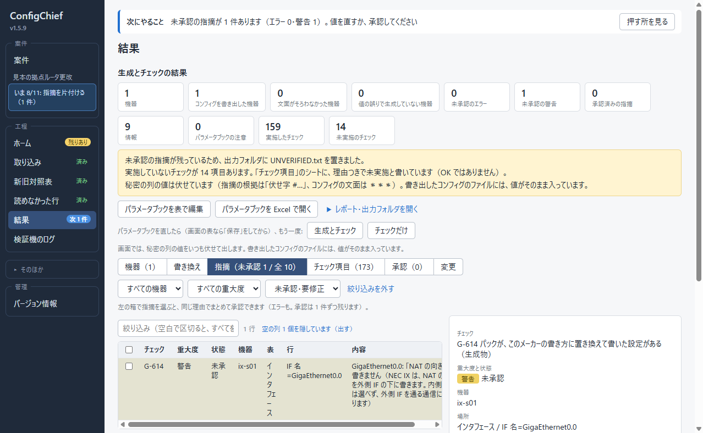

# ConfigChief

**Network device configurations ⇄ a vendor-neutral Excel workbook.**
ConfigChief reads router configurations into a vendor-neutral table (an Excel "parameter book"), and writes configurations, a check report and delivery sheets back from that table. It is made for replacing routers, also across vendors.

- One Windows exe. No installer, no network access, no listening port
- The same input always gives the same output (no AI, no randomness inside)
- A line that could not be read is always listed as "unknown" — nothing is dropped silently
- The program knows no vendor: everything about a vendor lives in a text "vendor pack"
- Bundled packs: Cisco IOS / IOS-XE and NEC UNIVERGE IX
- The user interface and the documents are in Japanese (for now)

> **Not verified on real devices.** The bundled packs were written from the vendors' public command references. Run every generated configuration on a lab device before you use it.

The exe is not code-signed, so Microsoft Defender SmartScreen may warn on the first start ("More info" → "Run anyway"). Compare the SHA-256 of your download with the one on the release page. This is a spare-time project: issues are read, answers come on an irregular schedule. Never paste real configurations into an issue.

License: [MIT](LICENSE). Third-party notices: [THIRD-PARTY-NOTICES.md](THIRD-PARTY-NOTICES.md).

---

# ConfigChief（日本語）

ネットワーク機器のコンフィグを読んで、メーカーによらない表（Excel のパラメータブック）にし、その表からコンフィグ・チェック結果表・納品用のシートを出すツールです。機器の更改（同じメーカーでも、別メーカーでも）と新規構築に使えます。



## できること

- **取り込み**: 旧機器のコンフィグ（端末ログのままでも可）を読んで、表にします。行ごとに「取り込み済み・無視・未対応」が分かります
- **書き換え**: 同じ表から、別メーカーのコンフィグを出します（Cisco IOS ⇄ NEC IX）。書けない値・置き換えて書いた設定は、必ず指摘として出します
- **チェック**: 値の誤り、2 台の間の食い違い（IPsec・BGP・OSPF・VRRP など）、旧との違いを調べ、提出用のチェック結果表を出します。指摘は理由を付けて承認できます
- **自己点検**: 生成したコンフィグを読み直して、元の表と同じになることを毎回確かめます
- **検証と投入の後**: 検証機の投入ログから弾かれた行を探し、投入後の設定とパラメータブックの違いを出します
- **納品物**: Excel のひな形に値を流し込んだ納品用パラメータシート、相手に渡すパラメータ表
- **新規構築**: 空のパラメータブックから 1 台目を作り、複製して増やせます

対応している設定: 機器の基本・インタフェース・スタティック経路・ユーザ・遠隔ログイン・NTP・syslog・SNMP・VRF・OSPF・BGP・VRRP/HSRP・ACL・プレフィックスリスト・NAT・回線監視・PPPoE・IPsec（IKEv1）・GRE・DHCP・QoS。

## 守っていること

- exe 1 つ。インストール不要。**外部と通信しません。待ち受けポートを開きません**
- 同じ入力からは、いつも同じ出力（AI や乱数を使いません）
- 読めなかった行は「未対応」として必ず一覧に出します
- 本体はメーカーを知りません。メーカーの知識は、テキストのメーカーパックにあります

## ⚠️ 実機では確かめていません

同梱のパックは、メーカーが公開しているコマンドリファレンスを読んで作りました。実機の出力では確かめていません。**生成したコンフィグは、必ず検証機に流して確かめてから使ってください。** 何を確かめていないかは、各パックの README にあります（[Cisco IOS](internal/packs/cisco_ios/README.md)・[NEC IX](internal/packs/nec_ix/README.md)）。

## 使い方

1. [Releases](../../releases) から `ConfigChief.exe` を取り、好きなフォルダに置いて起動します（WebView2 ランタイムが要ります。Windows 11 には初めから入っています）
2. 「案件」で案件フォルダを作り、旧機器のコンフィグを `input/old/` に置いて「取り込み」
3. Excel で対応（旧ホスト名 → 新ホスト名・新メーカー、旧 IF 名 → 新 IF 名）を埋めて、パラメータブックにする
4. 「生成とチェック」で、全台のコンフィグとチェック結果表が出ます

署名の無い exe なので、初めて起動するときに Microsoft Defender SmartScreen の警告が出ることがあります。「詳細情報」→「実行」で起動できます。取った exe が本物かどうかは、リリースのページにある SHA-256 と比べて確かめられます（PowerShell: `Get-FileHash ConfigChief.exe`）。

くわしくは:

- [使い方](docs/manual.md)
- [シートと列の一覧](docs/tables.md)
- [チェックの一覧](docs/checks.md)
- [メーカーパックの書き方](docs/pack-guide.md)
- [開発記（Zenn）](https://zenn.dev/kjo145/articles/configchief-config-to-excel-and-back)

## ビルド

Go 1.26 系が要ります。npm も wails コマンドも要りません。

```
build.bat
```

`go vet` と `go test` の後、`build\bin\ConfigChief.exe` ができます。

コードとパックのコメントにある「spec 9.6」「appendix B 3.6」「cmdref 7.15」などは、作者の手元の設計メモの節番号です（設計メモは公開していません。決まりの中身は、このリポジトリの文書と各パックの README に書いてあります）。

## サポート方針

個人が余暇で作っているツールです。Issue と要望は読みますが、対応は不定期です。**Issue に実際のコンフィグを貼らないでください**（ホスト名・アドレス・パスワード・拠点名は伏せてください）。脆弱性の報告は [SECURITY.md](SECURITY.md) のとおり、非公開でお願いします。

本番の機器に入れる前に、生成したコンフィグを検証機で確かめるのは、使う人の責任でお願いします（MIT ライセンスのとおり、無保証です）。

## ライセンス

[MIT](LICENSE)。使っている部品のライセンスは [THIRD-PARTY-NOTICES.md](THIRD-PARTY-NOTICES.md) にあります。

作者: KJO
