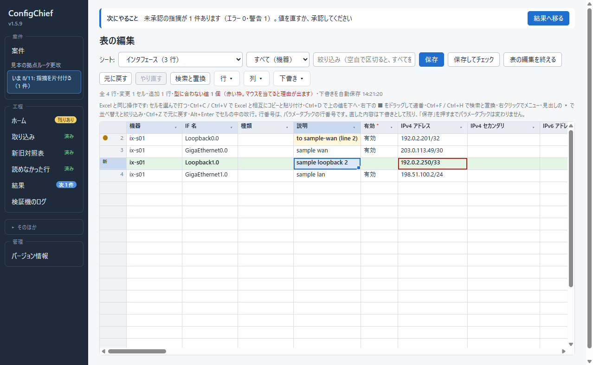
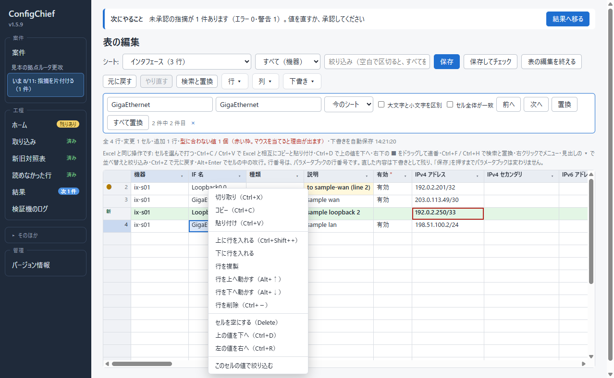

# ConfigChief の使い方

ConfigChief は、ネットワーク機器のコンフィグを読んでメーカーによらない表（Excel のパラメータブック）にし、その表からコンフィグ・チェック結果表・納品用のシートを出すツールです。

- exe 1 つで動きます。インストールは要りません。外部と通信しません（例外は、「バージョン情報」で「最新版を確認する」「最新版をダウンロード」を押したときだけです。10 章）
- 同じ入力からは、いつも同じ出力になります
- 読めなかった行は「読めなかった」として必ず一覧に出します（黙って落としません）
- 対応しているメーカーは Cisco IOS / IOS-XE（ルータ、内蔵スイッチ付きの小型ルータ、Catalyst 系のスイッチ）、NEC UNIVERGE IX（ルータ）、NEC QX シリーズ（スイッチ）です。メーカーごとの読み方・書き方は「メーカーパック」というテキストのファイルにあり、足すことができます（[パックの書き方](pack-guide.md)）
- 対応している設定: 機器の基本（ユーザ・遠隔ログイン・NTP・syslog・SNMP〈版 3 を含む〉・バナー・ログ）、インタフェース、VLAN・スイッチポート・LAG・スパニングツリー・ブリッジ・ポートミラー、スタティック経路・VRF・OSPF・BGP・VRRP / HSRP、経路制御の方針（ルートマップ・ポリシールーティング・AS パスとコミュニティのリスト）、ACL・プレフィックスリスト・NAT・回線監視、PPPoE・DHCP、IPsec（IKEv1・IKEv2）・GRE・EtherIP・L2TP（LNS・LAC・L2TPv3）、QoS、IPv6（アドレス・RA・DHCPv6・経路・フィルタ・OSPFv3・BGP・IPv6 の網のトンネル）。メーカーに機能が無いものや、パックが読まない書き方もあります（12 章と、各パックの README）

> **大事な注意**: 同梱のパックは、メーカーが公開しているコマンドリファレンスを読んで作りました。**実機の出力では確かめていません。** 生成したコンフィグは、必ず検証機に流して確かめてから使ってください。何を確かめていないかは、各パックの README（[Cisco IOS](../internal/packs/cisco_ios/README.md)・[NEC IX](../internal/packs/nec_ix/README.md)・[NEC QX](../internal/packs/nec_qx/README.md)）の「確かめていないこと」にあります。

ほかのページ: [シートと列の一覧](tables.md) ・ [チェックの一覧](checks.md) ・ [パックの書き方](pack-guide.md) ・ [申請用の説明](approval.md)

## 1. 起動する

`ConfigChief.exe` を置いて、ダブルクリックします。画面の表示には WebView2 ランタイム（Windows 11 には初めから入っています）が要ります。

- 署名の無い exe なので、初めて起動するときに Microsoft Defender SmartScreen の警告が出ることがあります。「詳細情報」→「実行」で起動できます。取った exe は、リリースのページの SHA-256 と比べて確かめられます（PowerShell: `Get-FileHash ConfigChief.exe`）
- 何も付けずに起動すると、画面が開きます。案件フォルダを付けて起動すると、その案件を開きます
- コマンドを付けて起動すると、窓を開かずにそのコマンドを行って終わります（9 章）
- 書き込むのは、案件フォルダの中（ふだんは `ConfigChief.exe` の隣の `projects` の下。2 章）と、`%APPDATA%\ConfigChief`（最近使った案件の一覧・案件の置き場所を変えたときはその場所・画面の拡大率・窓の位置と大きさ・内部エラーの記録 `error.log`・画面の作業フォルダ）だけです。レジストリは書きません（最新版の確認は、プロキシの設定をレジストリから読むだけです）
- 左のメニューの上の「工程」に、工程の順に画面が並びます（更改: ホーム・取り込み・新旧対照表・読めなかった行・結果・検証機のログ。新規: ホーム・表の編集・結果・検証機のログ。更改の表の編集は、ホームの「表で編集」・新旧対照表・指摘から開きます）。ふだんはここだけで進められます。追加コンフィグ・ひな形から作る・差分の投入・外部一覧・比較・検索・出力は「そのほか」に畳んであり、押すと開きます。案件の一覧は、いちばん上の「案件」から開きます（バージョン情報は、いちばん下の「管理」）
- 言葉: **新旧対照表**は、旧と新の割り当ての表です（「新旧対照表（機器）」: 旧ホスト名 → 新ホスト名・新機種、「新旧対照表（ポート）」: 旧 IF 名 → 新 IF 名）。**読めなかった行**は、ツールが表にできなかったコンフィグの行です（黙って落とさず、必ず一覧に出します）
- ホームのいちばん上に、案件の**工程の一覧**が並びます（更改: 旧コンフィグ → 取り込み → 新旧対照表（機器） → 新旧対照表（ポート） → パラメータブックに書く → 読めなかった行 → 生成とチェック → 指摘を片付ける → 検証機のログ → 納品物 → 投入後の確認。新規: 空のブック → 1 台目を書く → 生成とチェック → …）。済んだ工程に「済み」、することが残る工程に数（「3 行」「9 件」など）が出ます。工程を押すと、その画面へ移ります
- その下に「**次にやること**」が 1 つ出ます（例:「新旧対照表（機器）の新ホスト名が 3 台空です」）。右のボタン（「新旧対照表へ移る」のように、移る先の画面の名前が出ます）を押すと、その画面へ移り、押すボタンに枠が付きます。検証機のログと投入後の確認は「任意」で、ほかに残りが無いときだけ案内します
- **左のメニューで、案件が今どの工程にあるかが常に分かります**。案件名の下に「いま 3/11: 新旧対照表（機器）（2 台）」のように今の工程が出て、押すとその画面へ移ります。「工程」の各メニューの右には、次にやる画面に「次」、残りのある画面にその数、済んだ画面に「済み」が出ます
- 「次にやること」は、ホームのほかの工程の画面でも、いちばん上に 1 行で出ます。取り込みなどの操作が終わると、その場で次の工程に変わるので、「〜へ移る」を押せばそのまま進めます。次にやることがいまの画面のものなら「押す所を見る」が出て、押すボタンに枠が付きます。文の中の工程の名前には「（工程 4）」のように、上の工程の番号が付きます
- 窓の題名に、開いている案件の名前が出ます
- 初めて使うときは、「案件」の「**見本の案件を作る**」で、架空の旧コンフィグ（Cisco の拠点ルータ 2 台）を置いた案件を `projects\sample` に作れます。「次にやること」に沿って、取り込みから納品物まで一通り試せます（新旧対照表（機器）では、新メーカーに `nec_ix`、新機種に `ix-2ge-8sw` を書きます）
- 窓は、前に閉じたときの位置と大きさ（最大化も）で開きます。外部モニタを外したときなど、画面に収まらなければ縮めて動かします
- 画面の拡大率は Ctrl+ホイール、Ctrl+＋／Ctrl+−、Ctrl+0（100% に戻す）で、70〜150% の間で変えられます


## 2. 案件フォルダ

1 つの案件が 1 つのフォルダです。中身はテキストと Excel だけです。

**案件は、`ConfigChief.exe` の隣の `projects` フォルダの下に、案件名のフォルダで作ります**（`projects` は、初めて案件を作ったときにできます）。exe と案件がひとまとまりになるので、どこにあるかで迷いません。

```
ConfigChief\                ← exe を置いたフォルダ（例: C:\ConfigChief）
  ConfigChief.exe
  projects\                 ← 案件の置き場所
    拠点ルータ更改\          ← 案件名のフォルダ（1 案件 = 1 フォルダ）
    sample\                 ← 見本の案件
```

- 「案件」の画面の「**新しい案件を作る**」で、案件名と種類（更改・新規）を入れて「作る」を押します。作るフォルダ（`projects\<案件名>`）が、押す前に出ます。案件名に、フォルダ名に使えない字（`\ / : * ? " < > |`）は使えません。同じ名前のフォルダに中身があるときは作りません
- 「案件の一覧」に、`projects` の下の案件が名前の順に並びます。「開く」を押すだけで開けます。`projects` の外の案件は「ほかの案件フォルダを選んで開く」で開きます（開いたものは「最近開いた、置き場所の外の案件」に残ります）
- **exe は、書き込める手元のフォルダ（例: `C:\ConfigChief`・`D:\ConfigChief`）に置いてください**。`Program Files` の下など書き込めない場所では、案件を作るときに止まります。「デスクトップ」や「ドキュメント」は OneDrive で同期されていることが多いので、避けるのがおすすめです
- **案件名を変える**: ホームの案件名の横の「名前を変更」を押し、新しい名前を入れて「変更」を押します（やめるときは「キャンセル」）。案件フォルダの名前も一緒に変わります（案件名 = フォルダ名）。パラメータブックを Excel で開いているときや、エクスプローラで案件フォルダの中を開いているときは、フォルダの名前を変えられないので、閉じてからもう一度押してください。案件名は納品一式の名前やチェック結果表に入るので、変えた後は「生成とチェック」をやり直します
- ほかの場所に案件を集めたいときは、「案件の一覧」の「置き場所を変える」で選びます（この PC に覚えます。「ConfigChief.exe の隣に戻す」で戻せます）
- **フォルダは、使うときにできます**。作った直後の案件は `project.yaml` と `input\old`（更改のとき。旧コンフィグを置く場所）だけです。下の図のほかのフォルダは、ファイルを足す・保存する・生成するなど、そのフォルダを使ったとき（画面の「フォルダを開く」を押したときも）にできます
- ツールが付けるフォルダ名・ファイル名は英語です（`projects`・`sample`・`input`・`out` など）。日本語になるのは、案件名など使う人が付ける名前だけです。納品一式の名前だけは、日本語と英語を案件ごとに選べます（10 章）
**案件フォルダは手元（ローカル）で持ちます**。人に渡すときは、フォルダごとコピーするか、10 章の「案件の書き出し・読み込み」を使います。共有フォルダ・ネットワークドライブ・OneDrive の中の案件を開くと、ホームに注意が出ます（開くことはできます。同期や、ほかの人の保存とぶつかることがあります）。

使っていくと、次のフォルダとファイルができます。

```
案件フォルダ/
  project.yaml       案件の設定
  parameters.xlsx    パラメータブック（値の正本）
  input/old/         旧機器のコンフィグ（1 台 1 ファイル。端末ログのままでも読めます）
  input/new/         手で書いた新コンフィグ（使うときだけ）
  input/customer/    他のシステムなどが出力した一覧（xlsx・xls・csv）
  input/logs/        検証機・本番の投入ログ、投入後の設定ログ
  extra/             追加コンフィグ（パックが書けない設定を、人が書いて差し込む）
  mappings/          外部一覧の、列の対応
  fill/              ひな形（変数入りのコンフィグ。8 章）
  vars/              変数ルール（一覧の列 → 変数。8 章）
  rules/             案件ごとのチェックのルール
  templates/         納品用パラメータシートのひな形
  packs/             案件専用のメーカーパック（同じ ID の同梱パックより優先）
  state/             判定・承認・控え・操作の記録
  out/<日時>/        実行 1 回ごとの出力（コンフィグ、レポート）
```

- ツールが書き換えるのは、パラメータブック（はっきり操作したときだけ。書く前に `state/backup/` へ控えを取ります）と、`state/`・`out/` だけです。例外は、画面で保存したときの追加コンフィグ（`extra/`。7 章）・チェックの設定（`project.yaml` の `checks`。6 章）・列の割り当て・ひな形・変数ルールと、「ひな形の見本を作る」（`templates/` に新しいファイルを作るだけ。10 章）です。書き換える前の中身は `state/backup/` に控えます。`input/` は、「ファイルを足す」で写すほかは読むだけです。`out/` の中のフォルダは、「出力」の画面で選んで消したときだけ消します。改版履歴は `state/revisions.yaml` に残ります（10 章）
- **新しい案件を作るとき、前の案件の設定を写せます**: 「案件」の「新しい案件を作る」の「前の案件から設定を写す（しなくてよい）」を開いて、写す元の案件を選ぶと、納品用シートのひな形・案件のルール・チェックの設定・追加コンフィグ（全機器とグループの分。機器ごとの分は選んだときだけ）・列の割り当て・ひな形と変数ルール・案件のパック・持ち出し用レポートで残す語を写します。コンフィグ・パラメータブック・出力は写しません。元の案件は変えません（コマンドラインは `init --from <元の案件フォルダ>`）。部署の「標準の案件」を 1 つ作っておき、そこから始める使い方もできます
- **ファイルを置く**: ホーム・取り込み・ログ・外部一覧の画面の点線の枠に、エクスプローラからファイルかフォルダを落とすか、「ファイルを足す」で選ぶと、`input/old`・`input/new`・`input/logs`・`input/customer` に**写します**（元のファイルはそのままです。フォルダは直下のファイルだけ）。同じ名前で中身の違うファイルがあれば、上書きするかを聞きます（上書きした元のファイルは `state/backup/` に控えます）。エクスプローラで `input/` に置いてもかまいません。**旧コンフィグ・新コンフィグは、写したらそのまま取り込み**、取り込みの画面に結果を出します（押し直す手間はありません）。エクスプローラで置いたときも、取り込みの画面を開くと、前の取り込みから足した・消した・書き換えたファイルがあれば取り込み直します
- **Excel に 1 列 1 台で並んだコンフィグを置く**: 旧コンフィグ・新コンフィグの枠に Excel のファイル（xlsx・xlsm・xls）を落とすか選ぶと、そのファイルは写さずに「Excel の列からコンフィグを読み込む」の欄が開きます。シートと見出しの行（初めは、見出しらしい行が入っています）を選び、コンフィグにする列にチェックを付けて「選んだ ○ 列のコンフィグを読み込む」を押すと、列ごとに `<見出し>.txt` を作ります（見出しが空の列は `<シート名>_<列の英字>.txt`）。作ったら、そのまま取り込みます
  - 見出しの下のセルを、上から 1 セル 1 行でそのまま写します。行頭の空白（字下げ）もそのままです。空のセルは空の行になります
  - コンフィグの途中のメモの行も写します（黙って落としません）。取り込むと「読めなかった行」に出るので、「メモらしい行だけ」で絞って、まとめて「要らない」を付けてください
  - ホスト名は、コンフィグの中の `hostname` の行から取ります。無ければファイル名（＝見出し）になります
  - エクスプローラで `input/old` に Excel のファイルを置いたときは、取り込みで「Excel のファイルです」と出ます（中身は読みません）。「ファイルを足す」でそのファイルを選び直してください
- パラメータブックを Excel で開いたままだと書けません。書く操作の途中で「Excel でパラメータブックを閉じると、続けます」と出たら、Excel でブックを保存して閉じてください。閉じると、そのまま続きます（「やめる」で、何も書かずにやめられます。画面の表の「保存」も同じです）
- 文字コードは UTF-8 と Shift_JIS を自動で見分けます
- **同じ案件を 2 か所で同時に開くことはできません**。画面で案件を開いている間は `state/inuse.lock` に「開いている PC・ユーザー・時刻」を書いて持っておき、ほかの PC（共有フォルダ）や、もう 1 つの ConfigChief から開こうとすると、誰が開いているかを出して断ります。案件を閉じる・ConfigChief を閉じると中身を空にして放します（異常終了しても、Windows が放します）。コマンドラインも、画面で開いている案件には何もせずに止まります（終了コード 2）
- **新しい版の ConfigChief で使った案件を、古い版で開くと、読むだけになります**（新しい版が足した設定を、古い版が消さないため）。案件を開いた版は `state/tool.yaml` に残ります。画面の上に知らせが出て、保存・生成・承認など案件を書き換える操作は断られます。10 章の「バージョン情報」から最新版にしてください

## 3. 更改の流れ（機器の入れ替え。同じメーカーでも別メーカーでも同じ）

1. **案件を作り、旧コンフィグを置く**: 画面の「案件」の「新しい案件を作る」で、案件名を入れて作ります（`projects\<案件名>` ができます。2 章）。コマンドラインは `init <案件フォルダ>`。旧機器のコンフィグを、ホームの「旧コンフィグ」の枠に落とすか「ファイルを足す」で選びます（`input/old/` に写ります）。端末ソフトのログ（`show running-config` や `display current-configuration` を打った画面の保存）もそのまま置けます
2. **取り込む**: 画面の「取り込み」か `import`。ホームで置いたときは、置いたらそのまま取り込みます（取り込みの画面の「取り込み直す」で、もう一度取り込めます）。行ごとに、取り込み済み・無視・読めなかったが色で分かります。パラメータブックができ、「新旧対照表（機器）」のシートに旧機器の行が入ります
   - メーカーを自動で決められないファイルは、取り込みの画面で、候補からパックを選びます（`import --pack <ID>`）
   - 同じホスト名のファイルが 2 つ以上あるときは、取り込みの画面で、どれを取り込むかを選びます（`import --use <ファイル>`）。選ぶまで、そのホスト名のファイルはどれも取り込みません。選んだ結果は案件に残り、後から選び直せます
   
3. **新旧対照表（機器）を書く**: 「新旧対照表（機器）」に、旧ホスト名ごとの新ホスト名・新メーカー（パックの ID: `cisco_ios`・`nec_ix`・`nec_qx`）と、分かれば「新機種」を書きます。旧メーカーには、取り込みでそのファイルを読んだパックの ID が初めから入っています（▼ で選び直せますが、表示のための列で、読み方は変わりません。読み方を変えるのは取り込みでパックを選ぶときです）。「新旧対照表」の画面の「3. 新旧対照表（機器）」の表に、**そのまま書けます**（下の「段の中で書く」）。表の編集（同じ段の上の「表で編集する」。段で書きかけたものは、表の編集に持っていきます）でも、Excel でも書けます。**持っていかない機器は、新ホスト名に `-` と書きます**（理由は備考に。空は「まだ決めていない」です）
   - 表の編集では、書く 3 列（新ホスト名・新メーカー・新機種）の見出しに色が付きます。▼ の一覧にはパックの名前が添えてあり、新機種の ▼ には、その行の新メーカーの機種だけが出ます。新メーカーが空のまま新機種を選ぶと、新メーカーも埋まります。列の中の複数のセルを選んでから ▼ で選ぶと、まとめて入ります
   - **段の中で書く**（いちばん楽な書き方です）: 旧機器が 1 行 1 台で並びます。新ホスト名を打ち、新メーカーと新機種を ▼ から選びます（▼ にはパックの名前と機種のポートの並びが出ます。新機種の ▼ には新メーカーの機種だけが出て、機種を選ぶと新メーカーも入ります）。持っていかない機器は「持っていかない」にチェックします。書いた行には色が付き、「状態」に 未決・新機種が空・決まった・持っていかない が出ます。同じ新ホスト名が 2 台にあると、その欄に色が付きます
     - 新ホスト名の欄で Enter・↓ を押すと下の行へ、↑ で上の行へ進みます
     - **Excel から貼る**: Excel で新ホスト名の列を写して、新ホスト名の欄に貼ると、その行から下へ 1 行ずつ入ります。新ホスト名・新メーカー・新機種の 3 列を写して貼ると、3 つとも入ります（新メーカーはパックの ID でも名前でもかまいません）
     - **まとめて書く**: 左のチェックで行を選び（見出しのチェックで全部、「未決を選ぶ」「旧メーカーで選ぶ」）、新メーカー・新機種を選んで「入れる」。「新旧対照表（機器）」の下の欄で、「新ホスト名を旧ホスト名のままにする」（名前を変えない更改）・「持っていかない」・「新ホスト名を空に戻す」もできます
     - **名前の付け替え**: 名前の付け方が決まっているときは、旧ホスト名の「この文字を」→「この文字に」と、前・後ろに付ける文字を入れて「新ホスト名に入れる」。選んだ行の最初の 3 台の「旧 → 新」が下に出ます
     - 「すべて」「決まっていない」とホスト名の文字で絞れます。書いたものは「保存」まで書きません（画面を移っても残ります。「やめる（捨てる）」で捨てます）。**「保存」を押すとすぐパラメータブックに書き（確かめの窓は出ません。Excel でブックを開いているときなど、すぐ書けないときだけ知らせます）、新旧対照表（ポート）の案を作って「4. 新旧対照表（ポート）」へ移り、「旧 IF ごとに新 IF を選ぶ」の表が出ます**
     - 備考を書くときや行を足すときは、「表の編集・Excel で書く」を開いて「表で編集する」
   - **新旧対照表の画面は、上の 3 つのボタン（3. 新旧対照表（機器）・4. 新旧対照表（ポート）・5. パラメータブックに書く。番号はホームの工程の番号です）を順に押して進めます**。押した段の中に、することと「表で編集する」などのボタンが出ます。各ボタンに残りの数か「済み」が出て、画面を開くと残りのある段が開きます
   - 表の編集で「新旧対照表（機器）」を保存すると、新旧対照表の画面の「4. 新旧対照表（ポート）」へ移ります（「新旧対照表（ポート）」を保存すると「5. パラメータブックに書く」へ）。**表の上の「すべて（新ホスト名）」で機器を 1 台に絞って保存したときは、表の編集に残り、「次の機器へ（名前・残り n 行）」が出ます**。押すと、新 IF 名が空の行のある次の機器に絞り直します
4. **新旧対照表（ポート）を確かめる**: 画面の表で「新旧対照表（機器）」を保存すると、新ホスト名を書いた機器の IF が「新旧対照表（ポート）」（旧 IF 名 → 新 IF 名）に入ります（**取り込み直しは要りません**）。Excel で書いたときは、「新旧対照表」の画面の「4. 新旧対照表（ポート）」の「案を作る」を押します。表には、旧 IF 名の横に「旧ホスト名」と「旧 IF の設定」（説明・アドレス・VLAN・スイッチポート〈アクセス VLAN・トランクの許可 VLAN・音声 VLAN〉・無効・ACL・NAT・対向と、その IF を使っている設定〈OSPF・VRRP・スタティックルートなど〉）が出ます。新 IF 名が空は「まだ決めていない（未決）」、`-` は「新しい機器に持っていかない」です（段の一覧では「（未決）」「-（持っていかない）」と出ます）。どの旧 IF をどの新 IF にするかを決める手がかりにしてください（ツールが取り込むたびに書き直す列です）。表の編集では、新 IF 名を ▼ から選べます（新機種のポート・その機器に書かれている名前・`-`。ほかの旧 IF に割り当て済みの名前には「割り当て済み」と出ます。一覧に無い名前も、そのまま打てます）。表の上の「**設定のない旧 IF を「-」にする**」で、設定の無い旧 IF と止めてあるだけの旧 IF に `-` を入れられます（複数の行を選んでいれば、その行だけ。保存するまで書きません）。新 IF 名には、次の順で案が入ります（「根拠」の列に、どの案かが出ます）。新 IF 名が空の行にも、案があれば入ります（人が書いた名前と `-` は変えません）
   - 「新機種」に、パックが知っている機種の ID を書いた機器は、**その機種のポートの並びから新 IF 名を割り当てます**。内蔵スイッチのポートはスイッチのポートへ、L3 のポートはそれ以外のポートへ、名前の順に並べます。新しい機種に同じ名前のポートがあれば、その名前のままにします。止めてあるポートは `-`（持っていかない）。VLAN の IF・サブ IF・ループバック・トンネル・LAG の IF・PPPoE の論理 IF も、新しいメーカーの名前の形にします
   - 新コンフィグ（`input/new/`）に同じ名前の IF があれば、その名前
   - どちらも無ければ空です。人が書きます（`-` は持っていかない）
   - **旧 IF ごとに新 IF を選ぶ**（いちばん楽な書き方です）: 「4. 新旧対照表（ポート）」を開くと、この表が出ます。上で機器を 1 台選ぶと、その機器の旧 IF が 1 行ずつ、旧 IF の設定（説明・アドレス・VLAN・スイッチポートなど）と並びます。各行の右の ▼ で、新しい機器のどの IF にするかを選びます。▼ には「（未決）」「-（持っていかない）」、空いている IF、ほかの旧 IF が使用中の IF（選ぶと付け替え。前の旧 IF は未決に戻ります）、「一覧に無い名前を打つ…」が出ます。選んだものは「保存」を押すまで書きません（機器を替えても残ります）。「保存」はすぐ書き、その機器が済んでいれば、残りのある次の機器へ進みます。「まとめて」には「設定のない旧 IF を「-」にする」と「この機器の選び方を同じ形の機器へ写す」があります。表の編集・案を作る・Excel・全機器の一覧は「そのほか」に畳んであります。**空欄と - は別です**: 空欄は「まだ決めていない（未決）」で、承認して進めるとその IF は旧の名前のまま新しい機器に入ります。使わない IF は「-（持っていかない）」にします（パラメータブックに書かず、その IF を指す欄も空にします）。保存したときに未決が残っていれば知らせが出て、「残りの n 行を全部「-」にする」で一度に - にできます
   - **内蔵スイッチの VLAN と物理ポート**: 旧の VLAN の IF（`Vlan10` など）の新 IF を、新しい機器の VLAN グループの IF（NEC IX の `GigaEthernet1:1.0` など）にすると、そのグループに入る物理ポートは、旧のアクセスポート（旧 IF の設定に「アクセス VLAN 10」と出ます）の行で新しい物理ポート（`GigaEthernet1:port1` など）を選ぶと決まります。VLAN の IF の行の下に、その VLAN の物理ポートが 1 行で出ます（サブ IF のタグは「タグ VLAN 10」と出て、こちらは対象外です）。**旧に無い物理ポートを VLAN に入れるときは**、表の下の「新しい機器の、まだ使っていない物理ポート」で、そのポートの ▼ から「VLAN 10 に入れる」を選んで保存します（使わないポートは「使わない」のまま）。パラメータブックに書くとき、そのポートをスイッチポートの表にアクセスポートとして、インタフェースの表に有効なポートとして足します（新旧対照表（ポート）のシートでは、VLAN の IF の行の「足すポート」の列に入ります。表の編集や Excel で、カンマで区切って書いても同じです）
   - **同じ形の機器へ写す**: 1 台を結んだら「この割り当てを同じ形の機器へ写す」を押します。新機種が同じ機器のうち、旧 IF 名の並びが同じ機器（同じ形）にチェックが付いて出ます（一部だけ同じ機器は「重なる旧 IF n / m」と出ます）。「写す」で、同じ旧 IF 名の行に新 IF 名を入れます。入れるのは、新 IF 名が空の行と、ツールの案のままの行だけで、人が書いた新 IF 名は変えません。大・中・小の拠点のように形が何種類かある案件は、形ごとに 1 台を結んで写し、写した機器は「機器」の ▼ で選んで確かめてから「保存」します
   新旧対照表（ポート）は、画面の表（「4. 新旧対照表（ポート）」の「表で編集する」）でも Excel でも直せます。機種から作る案の決まりは、下の「機種から 新旧対照表（ポート）の案を作る」にあります
   - 後から「新機種」を書いた・変えた機器は、「新旧対照表」の画面の「4. 新旧対照表（ポート）」の「**案を作り直す**」で、その機器を選んで作り直します。作り直す前と後の一覧が出て、「書く」で書きます。入れ替えるのは、「根拠」の入っている行（ツールの案のまま）と、新 IF 名が空の行だけです。根拠が空で新 IF 名のある行（人が書いた名前と `-`）は変えません
   - 画面の表で新 IF 名を直して保存すると、その行の「根拠」を空にします（人が決めた名前として、作り直しで上書きされなくなります）。**Excel で新 IF 名を直したときは、「根拠」も空にしてください**
5. **パラメータブックにする**: 「新旧対照表」の画面の「5. パラメータブックに書く」の段で、上の「1. 決まっていないところを確かめる」で直すか承認し（左の箱で選んで、まとめて承認できます。未承認が無くなると「すべて承認済みです」と出ます）、下の「2. パラメータブックに書く」の「パラメータブックに書く」を押します（コマンドラインは `book`）。旧コンフィグの設定を、新旧対照表で決めた新しいホスト名・IF 名に置き換えて、パラメータブックの各シートに書き込みます。書いた後は「次の工程へ」で、読めなかった行の確認と「生成とチェック」へ進みます。これ以降は、このパラメータブックが値の正本です。値は、画面の「表の編集」でも Excel でも直せます（5 章）
   
6. **読めなかった行を片付ける**: 画面の「読めなかった行」か `judge`。同じ形の行をまとめて、「追加コンフィグで書く」・「要らない」・「保留」を付けます。**数が多いときは、一覧を文字と「メモらしい行だけ」で絞り、「表示しているかたまり ○ 個に、まとめて判定を付ける」で 1 回で付けます。一覧の左の箱で選んで「選んだ ○ 個に付ける」でも付けられます（見出しの箱で全部）**（Excel のメモの行をまとめて「要らない」にするなど）。機器ごとの行の「この行で追加コンフィグの下書きを作る」を押すと、その行を追加コンフィグの下書きに入れて開きます。保存すると、その機器のその行に「追加コンフィグで書く」が付き、「読めなかった行へ戻る」で戻れます（7 章）
7. **生成とチェック**: ホームの「生成とチェック」か `generate`。全台のコンフィグ（`out/<日時>/configs/`）と、チェック結果表（`reports/check_results.xlsx`・`.html`）が出ます。値の誤りがある機器のコンフィグは書きません。結果の画面の「コンフィグを見る」で機器を選ぶと、そのコンフィグが画面に出て、「全部コピー」で端末に貼れます。案件を開き直しても、結果の画面を開くと、いちばん新しい出力の結果が出ます（指摘は今のブックで数え直します）
   - **書き換えレポート**: 更改の案件（旧コンフィグがあり、「新旧対照表（機器）」に新ホスト名を書いた案件）では、「生成とチェック」「チェックだけ」のたびに `reports/rewrite.xlsx` が出ます。旧コンフィグのすべての行を、自動で書き換えた／読めなかった行／新メーカーのパックが書けない／新機種が対応していない／旧と値を変えた／確かめられない／無視 のどれか 1 つに入れ、旧の行・行き先（パラメータブックの表と列）・新の行を 1 行ずつ並べます。読み合わせは、この 1 枚で旧の行から新の行を追えます。「自動で書き換えた」「無視」以外の行を見てください。「新にだけある行」には、追加コンフィグなど新で足した行が出ます。結果の画面の「書き換え」のタブでも、区分と機器で絞って見られます
   
8. **指摘を直すか、承認する**: 指摘には、内容と「直し方」が出ます（画面の指摘の詳細と、チェック結果表の「指摘」のシート）。エラーと警告は、値を直すか、承認します。指摘の「このセルを表で開く」を押すと、そのセルを選んだ状態で表の編集が開きます（Excel で直してもかまいません）。直したら、表の編集の「**保存**」（か「保存してチェック」）を押すと、保存してチェックし直し、残った指摘の一覧へ戻ります（ホームの「表で編集」や左のメニューから表の編集を開いたときの「保存」は、表の編集に残ります）。「生成とチェック」の後、片付ける指摘があれば、結果の画面は「指摘」のタブで開きます。未承認の指摘が残っている間は、出力フォルダに `UNVERIFIED.txt` が置かれます
9. **検証機で確かめる**: 1 台分を検証機に流し、その端末ログを検証機のログの画面の枠に落として（`input/logs/` に写ります）、画面の「検証機のログ」か `logs`。機器に弾かれた行が一覧に出ます
10. **変更が来たら**: パラメータブックを直して（画面の表か Excel）7 をやり直します。2 回目からは、前回から変わった機器と行の一覧（`reports/changes.xlsx`）が出ます。機器に入れるのが「変えるコマンドだけ」のときは、「**差分の投入**」で、今のコンフィグとの差から投入を作れます（10 章）
11. **納品物を出す**: ホームの「納品物」の「**納品一式を作る**」か `export --what delivery`。いちばん新しい生成のコンフィグ・チェック結果表と、納品用パラメータシート・相手に渡すパラメータ表を、1 つのフォルダ（と zip）にまとめます（10 章）。シートや表だけを出すこともできます
12. **投入の後**: 投入後の設定のログを検証機のログの画面の枠に落として（`input/logs/` に写ります）、画面の「検証機のログ」で「投入後の確認」を選び「比べる」を押すか `verify`。パラメータブックから作ったコンフィグとの違いが出ます

### 論理ポートを引き継ぐ・分ける・足す

VLAN の IF・サブ IF・トンネルなどの論理ポートは、次のように書きます。

- **そのまま引き継ぐ**: 新旧対照表（ポート）で、旧の論理 IF に新しい名前を書きます。その IF を使っている設定（ACL・NAT・OSPF・VRRP など）も、新しい名前で入ります。一部だけ引き継ぐときは、パラメータブックに書いた後、要らない値を表の編集で消します
- **分ける**: 引き継いだ後、表の編集の「インタフェース」のシートで、その行を選んで「行を複製」し、新しい IF 名を書いて、移す値（アドレスなど）を移します。同じアドレスが 2 つの IF に残っていれば、チェックが知らせます
- **足す**（旧では使っていないアドレスで、新しい論理 IF を作るなど）: 使わなくなる旧の論理 IF は、新旧対照表（ポート）で新 IF 名を `-` にします。新しい IF は、パラメータブックに書いた後、「インタフェース」のシートに行を足します（VLAN の IF なら「VLAN」のシートにも）
- 後から「パラメータブックに書く」をもう一度押しても、人が足した行と直した値はそのまま残ります（足りない行を足すだけです）。足した行は、書き換えレポートの「新にだけある行」に出るので、読み合わせで確かめられます

### 機種から 新旧対照表（ポート）の案を作る

「新旧対照表（機器）」の「新機種」に、パックが知っている機種の ID を書くと、新旧対照表（ポート）の新 IF 名の案を、その機種のポートの並びから作ります。ID は製品の名前ではなく、ポートの並びを言う名前です（数字はポートの数）。

| パック | 機種の ID |
|---|---|
| Cisco IOS | `isr-4fe-1fe`・`isr-8fe-1fe-1ge`・`isr-xe-8ge-2ge`（内蔵スイッチ付きの小型ルータ） |
| NEC IX | `ix-1ge-4sw`・`ix-2ge-8sw`（内蔵スイッチ付き）、`ix-4ge` |
| NEC QX | `qx-24ge-4xge`・`qx-48ge-4xge` |

- 旧機器のポートを名前の順に並べ、内蔵スイッチのポートは新しい機種のスイッチのポートへ、L3 のポートはそれ以外のポートへ割り当てます。新しい機種に同じ名前のポートがあれば、その名前のままにします。止めてあるポートは `-`（持っていかない）です
- VLAN の IF・サブ IF・ループバック・トンネル・LAG の IF・PPPoE の論理 IF も、新しいメーカーの名前の形にします
- 案は、新旧対照表（ポート）に行を足すときと、**新 IF 名が空の行** に入ります（人が書いた新 IF 名と `-` は変えません）。後から「新機種」を書いた・変えた機器は、「新旧対照表」の画面の「案を作り直す」で作り直します（「根拠」の入った行だけを入れ替えます。3 章の 4）
- 案は、人が見て直す前提のものです（アップリンクのポートなど）。ポートの数が足りないときや、当たる名前の形が無いときは、空のままにします
- **機種のチェック**: シート「機器」の「機種」（更改では「新旧対照表（機器）」の「新機種」）に機種の ID を書くと、インタフェースの表の IF 名がその機種のポートか論理 IF（ループバック・トンネル・VLAN の IF など）に当たるかを確かめます（V-111。エラー）。機種に無い機能を使っていればエラーになります（G-607。今は NEC IX の `ix-4ge` の内蔵スイッチだけ）。機種が空か定義に無い機器は「情報」（V-114）として知らせるだけで、生成は止めません。ID に似た打ち間違いは警告（V-116）で、似た ID を示します
- どの ID がどのポートを持つかは、各パックの README の「機種の定義」の節にあります。ここに無い機種は、案件フォルダのパックに `models.yaml` を置いて足せます（[パックの書き方](pack-guide.md)）

### 別メーカーへ書き換えるとき

「新旧対照表（機器）」の新メーカーを変えると、同じパラメータブックから別メーカーのコンフィグが出ます。新しいメーカーで書けないものは、次のように知らせます。どれも黙って落としません。どの指摘にも、画面とチェック結果表に「直し方」が出ます。

| 出方 | 意味 | すること |
|---|---|---|
| G-602（エラー） | 値があるのに、新しいメーカーのパックがその列を書かなかった（新しいメーカーに当たる行が無い、パックが確かめていない） | 持っていかないなら、セルを空にする。別の書き方で持っていくなら、追加コンフィグ（7 章）に書いてからセルを空にする |
| G-603（エラー） | その語（暗号の種類など）が、新しいメーカーに無い | 指摘の文にある、書ける語に直す。その語が要るなら、セルを空にして追加コンフィグに書く |
| G-601（エラー） | 列は書けるが、その値・組み合わせが新しいメーカーで書けない（ポートの番号が機種に無い、機器に 1 つしか持てない値が行ごとに違う、暗号化して保存した形の鍵、など） | 指摘の文に、理由と、書ける値・直し方があります。そのとおり値を直す |
| G-606（エラー） | 新しいメーカーで要る値が空 | 指摘の文にある列に、値を入れる |
| G-614（警告） | パックが、新しいメーカーの書き方に置き換えて書いた（例: QoS の「残りの帯域の %」を「帯域の %」に、Cisco の `Vlan10` を NEC IX のポート VLAN に） | 指摘の文で、何をどう置き換えたかを読む。それでよければ承認する。よくなければ値を書き直す |

置き換え（G-614）は、パラメータブックの値を変えません。書き出しのたびに、同じ置き換えをします。メーカーの組み合わせごとの決まりの全部は、新しいメーカーのパックの README（「置き換え」の節）にあります。よくある組み合わせの要点を下に挙げます。

#### 内蔵スイッチ付きの小型ルータ（Cisco）→ NEC IX

NEC IX の内蔵スイッチのポートは、機器の上では IF ではありません（`device` の下の `port <番号>`）。表では、パックが付けた名前 **`<デバイス名>:port<番号>`**（`GigaEthernet2:port1` など）で 1 行ずつ持ちます。この名前はコンフィグには出ません。人が決めるのは、新旧対照表（ポート）の新 IF 名だけです。

| 旧機器 | 新旧対照表（ポート）の新 IF 名 | パックの書き方 |
|---|---|---|
| スイッチポート（`FastEthernet0` など） | `<デバイス名>:port<番号>` | ポートを VLAN グループに入れます |
| `Vlan<n>`（トランクに通さない VLAN） | ポート VLAN の IF `<デバイス名>:<グループ>.0` | その VLAN のアクセスポートを、そのグループの `vlan-group` に入れます。アドレスはグループの IF に付きます |
| `Vlan<n>`（トランクに通す VLAN） | BVI（`BVI0` など） | VLAN ごとのブリッジグループにし、`bridge irb enable` を書きます |
| トランクのポート | `<デバイス名>:port<番号>` | 通す VLAN ごとにタグ付きのサブ IF を作り、その VLAN のブリッジグループに入れます |
| WAN のポートとそのサブ IF | L3 のポート（`GigaEthernet0.0`）、そのサブ IF（`GigaEthernet0.1` など） | — |

- 「新機種」に NEC IX の機種の ID（`ix-1ge-4sw`・`ix-2ge-8sw`）を書くと、上の新 IF 名の案をツールが作ります。機種が分かる機器では、IF 名が機種のポートか論理 IF に当たるか（V-111）と、VLAN グループの番号が機種に合うかを確かめます
- NEC IX に無い設定は、外して G-614 で知らせます: スパニングツリー（PortFast・BPDU ガードなど）、VLAN の定義と名前、ポートの説明、CDP・LLDP など。ポートセキュリティ・ストーム制御・DHCP スヌーピングなど通信を絞る設定は、外さずに G-602 で知らせます
- 書けないものは止まります（G-601）: モード dynamic のポート、束ね方が on（固定）でない LAG（NEC IX に LACP はありません）、1 つの VLAN グループに 9 つ以上のサブ IF が要るトランク、ポート VLAN の IF にした VLAN を通すトランク（「VLAN の IF を BVI に」と知らせます）
- 細かい決まりは、NEC IX のパックの README の「VLAN とスイッチ」の節にあります

#### Catalyst 系のスイッチ ⇄ NEC QX

- **IF 名**: 新しいメーカーの名前にします（QX は `GigabitEthernet1/0/1`・`Vlan-interface<番号>`・`Bridge-Aggregation<番号>`、Cisco は `Vlan<番号>`・`Port-channel<番号>` など）。QX へは、「新機種」に `qx-24ge-4xge`・`qx-48ge-4xge` を書くと案ができます（同じ名前のポートは、その名前のまま）。Catalyst 系の機種の定義は無いので、QX → Catalyst の新 IF 名は人が書きます
- **Cisco → QX の置き換え（G-614）**: スパニングツリーの「使う」が空でスイッチポートがある機器には、`stp global enable` を書きます。pvst は rapid_pvst に、PortFast の既定はアクセスポートごとの `stp edged-port` に、PAgP の束ね方は LACP（active）にします。番号の ACL は QX の番号に付け替えます（標準 1〜99 → 2001〜2099 など）。IF に当てた ACL の最後に「残りをすべて止める」行を足します（QX のフィルタは、どの行にも当たらない通信を通すため）。トランクの「許可 VLAN」が空なら all にします
- **QX → Cisco の置き換え（G-614）**: rstp・stp は mst に、QX の番号の ACL は名前 `ACL-<番号>` に、0 から始まる ACL の順番は 10・20・30 … に振り直します。hybrid のポートは、タグなしで通す VLAN がネイティブ VLAN 1 つだけのときに trunk にします（ほかは止まります）
- **止まるもの（G-601）**: QX へは、HSRP・サブ IF・`Tunnel` の IF、モード dynamic のポート。どちらへも、機器が暗号化して保存した別メーカーの値（QX の `cipher …`、Cisco の `7 …` など。平文を入れ直します）
- 細かい決まりは、NEC QX のパックの README の「書き換えで置き換えること」と、Cisco のパックの README の「別メーカーのスイッチ（NEC QX）のデータを書くとき」にあります

#### IPsec・L2TP/IPsec（Cisco ⇄ NEC IX）

- **相手の決まっていないトンネル**: Cisco の仮想テンプレート（`Virtual-Template<数>`）と、NEC IX の相手が any のトンネル IF は、どちらも「方式 tunnel_if・相手 any」の 1 行です。新旧対照表（ポート）で、Cisco の `Virtual-Template<数>` と NEC IX の `Tunnel<番号>.0` を対にします（Cisco へは、行の「トンネル IF」が `Virtual-Template<数>` でないと止まります）
- **暗号化して保存した鍵は、別メーカーへは行きません**: Cisco の `6 <値>`、NEC IX の `secret <値>` の形の鍵は、同じメーカーへはそのまま書き戻せますが、別メーカーへは止まります（G-601）。平文の鍵を入れ直します
- **機器に 1 組しか持てない値**: Cisco は、IKE のポリシー（版 1）・プロポーザル（版 2）を機器に 1 組だけ書きます。版ごとに、全部の行の IKE の暗号・ハッシュ・DH グループなどがそろっていないと止まります
- **名前はパックが決めます**: キーリング・プロファイル・トランスフォームセット・マップの名前は表に持たず、書き出すメーカーのパックが決めます
- **外側の VRF**（IPsec を運ぶ側の VRF）は、Cisco だけが書けます。NEC IX へは止まります
- **L2TP/IPsec の受け口（LNS）**: NEC IX は同時につなぐ数だけトンネル IF を持ち、Cisco は `Virtual-Template` を 1 つ使います。Cisco へは、「受け口の IF」が `Virtual-Template<番号>` 1 つでないと止まります。L2TP を守る IPsec は、L2TP の行の「IPsec の設定名」が指す IPsec の行です
- **L2TPv3** は NEC IX にありません（止まります）。NEC IX で L2 をつなぐのは EtherIP です（Cisco へは止まります）
- 細かい決まりは、両方のパックの README の「IPsec」「L2TP」の節にあります

#### IPv6・IPoE

- IPv6 のアドレス・RA・スタティック経路・フィルタ・プレフィックスリスト・OSPFv3 は、3 つのメーカーとも表にしています（メーカーによって書けない列があります）。BGP の IPv6 は Cisco と NEC QX だけです（NEC IX の BGP は IPv4 だけで、止まります）
- IPoE の回線のトンネル（MAP-E・DS-Lite・固定 IP の IPIP）は、NEC IX のパックが読み書きします。Cisco の MAP-E は規則を手で書く形で、公開資料の書き方が版によって食い違っていて確かめられず、NEC IX にも規則を手で書く形が無いので、表にしていません。MAP-E などのトンネルを Cisco へ書き出すと止まります
- DHCPv6 で下流のルータへプレフィックスを配る設定（決めたプレフィックスから配る・上流からもらったプレフィックスを配り直す）は、「IPv6 インタフェース」の DHCPv6 サーバの行に書きます。配り直しは NEC IX だけで、端末へのアドレスの配布は Cisco だけです
- DNS・NTP・syslog・SNMP の宛先と回線監視の監視先は、IPv6 のアドレスでも書けます。NEC IX の IPv6 の監視は出力 IF が要り、送信元をアドレスで書くので、Cisco から書き換えると、IPv6 の経路の出力 IF と送信元 IF のアドレスを入れて知らせます。NEC IX の名前の回線監視を Cisco へ書き換えると、番号を振って書き、指す行も合わせます
- OSPFv3 の認証は Cisco だけです（NEC IX の OSPFv3 に認証は無く、止まります）
- IPv6 の VRRP（版 3）は、シート「冗長化（IPv6 の VRRP）」に書きます（Cisco・NEC IX）。Cisco は機器全体を版 3（`fhrp version vrrp v3`）にすると IPv4 の VRRP も版 3 になり、NEC IX の IPv4 の VRRP は版 2 だけなので、シート「機器」の「VRRP の版（IPv4）」で持ちます。両方がそろってもつながらない組（片方が版 3 だけ、もう片方が版 2）は X-405 で知らせます。書き換えでは、Cisco へは機器を版 3 にして IPv4 のグループに「版 2 の相手とも話す」（`vrrpv2`）を付け、NEC IX へは IPv4 のグループを版 2 で書き、どちらも知らせます。NEC IX の IPv6 の VRRP の回線監視は書けません（止まります）。NEC QX のパックは、この表を読み書きしません
- 対応している行と書けない値は、各パックの README の「IPv6」の節にあります

## 4. 新規構築の流れ

1. 案件を作り、ホームの「空のブックを作る（新規構築）」か `book --new`。見出しだけのパラメータブックができます。見出しのセルのコメントに、列の説明と記入例があります
2. 1 台目を、シート「機器」から書きます（ホスト名とメーカーは必須です）。画面の「表の編集」でも Excel でも書けます。見出しだけのブックに無い表のシートは、表の編集の「まだシートが無い表」から作れます（5 章）。「機種」に機種の ID（3 章の「機種から 新旧対照表（ポート）の案を作る」）を書くと、パックがポートの番号などを機種に合わせて確かめます（確かめるのは、それを持つパックだけです）
3. 似た機器は、ホームの「機器の複製」か `clone --from <元> --to <新しいホスト名,…>` で増やします。値は元のままなので、アドレスなど機器ごとに違う値を直します（重なりはチェックが指摘します）
4. 全台に共通の値は、「機器」の列に `*`（全機器）か `@グループ名` を書いた 1 行で書けます。空の列をまとめて埋めたいときは、シート「共通値」を使います
5. あとは更改の 7 以降と同じです

### コンフィグを先に手で書く進め方

手で書いたコンフィグを `input/new/` に置いて取り込み、`book --from new` でパラメータブックにできます。旧コンフィグがあれば、「比較」で旧と新を比べて、入れ忘れと値の違いを確かめられます。

## 5. パラメータブック

- 1 つのシートが 1 種類の設定、1 行が設定 1 件です。設計データのシートは 68 種類あり、ほかに管理用のシート「新旧対照表（機器）」「新旧対照表（ポート）」「共通値」があります。値の無い表のシートは、ブックに作らないこともあります（画面の表の編集で作れます）。シートと列の一覧は [tables.md](tables.md)
- 1 行目が見出しです。列の順番は自由で、定義に無い見出しの列を足してもかまいません（自由列。追加コンフィグと納品用シートから使えます）
- 有効・無効は `有効` `無効`、`○` `×`、`yes` `no`、`true` `false` のどれでも読みます
- 複数の値を持つ列は、カンマか改行で区切ります
- 秘密の値（パスワード・鍵）は平文で書きます。画面・チェック結果表・変更一覧では伏せ、生成するコンフィグには書きます
- **機器が暗号化して保存した値**（Cisco の `7 0822455D0A16`・`6 <値>`、NEC IX の `secret <値>`、NEC QX の `cipher <値>` など）を取り込むと、機器が出したとおりに「種別 値」と空白で区切った形で、秘密の値のセルに入ります（V-283 で知らせます）。同じメーカーの機器へは、そのまま書き出せます。別メーカーへは引き継げないので、生成が止まります（G-601）。平文の値を入れ直してください。「ユーザ」と「機器」のシートは、値だけを入れて「パスワードの形」の列で見分けます
- 同じキーの行が「ホスト名」「`@グループ名`」「`*`」の複数にあるときは、ホスト名 ＞ グループ ＞ `*` の順で 1 行を取ります

分野ごとのシートは次のとおりです（シート名。くわしくは [tables.md](tables.md)）。

| 分野 | シート |
|---|---|
| 機器の基本 | 機器、ユーザ、遠隔ログイン、NTP サーバ、ログ転送先、ログの対象ごとの重要度、SNMP コミュニティ、SNMP 通知先、SNMP ユーザ（版 3） |
| インタフェース | インタフェース、トンネル、接続 |
| VLAN とスイッチ | VLAN、スイッチポート、LAG のメンバー、L2 の全体設定、VLAN ごとのスパニングツリー、MSTP のインスタンス、スタックのメンバー、ポートミラー、ブリッジグループ |
| 経路 | スタティック経路、VRF、OSPF、OSPF インタフェース、OSPF エリア、OSPF 集約、OSPF 再配布、OSPF バーチャルリンク、BGP、BGP ネイバー、BGP 広告経路、BGP 再配布、BGP 集約経路、冗長化（VRRP・HSRP）、冗長化（IPv6 の VRRP） |
| 経路制御の方針 | 経路制御の方針、AS パスのリスト、コミュニティのリスト |
| リスト・NAT・回線監視 | ACL、ACL 行、時間帯、プレフィックスリスト、NAT、回線監視 |
| 回線・DHCP | PPPoE、DHCP |
| IPsec・L2TP | IPsec、IPsec 対象通信、IPsec 追加の提案、IPsec の全体設定、L2 延伸（L2TPv3）、L2TP、L2TP 接続ユーザ |
| QoS | QoS の見分け方、QoS の見分け方の条件、QoS のポリシー、QoS の適用 |
| IPv6 | IPv6 インタフェース、RA のプレフィックス、IPv6 スタティック経路、IPv6 フィルタ、IPv6 プレフィックスリスト、OSPFv3、OSPFv3 インタフェース、OSPFv3 エリア、OSPFv3 再配布の指定、BGP IPv6 ネイバー、BGP IPv6 再配布の指定 |
| 管理用 | 新旧対照表（機器）、新旧対照表（ポート）、共通値 |

どのメーカーのパックがどのシートを読み書きするかは、各パックの README の「対応一覧」にあります。パックが書かないシートに値があると、生成で G-602 として知らせます。

### 画面の表で直す（Excel が無くても直せます）

左の「表の編集」で、パラメータブックのシートを表として開いて直せます。ファイルは今までどおり xlsx のままで、Excel で直す使い方もそのまま使えます。



- **シートを選ぶ**: 設定の表のシート全部と、「新旧対照表（機器）」「新旧対照表（ポート）」「共通値」。機器で絞り込めます。`*`・`@グループ名` の行もそのまま直せます
- **まだシートが無い表**: 古いブックや、新しく増えた表のように、ブックにまだシートが無い表は、シートの一覧の「まだシートが無い表」に出ます。選ぶと見出しだけの表が開き、行を足して保存すると、ブックにそのシートができます（見出し・列の説明・選択肢は、ツールが作るほかのシートと同じです）
- **Excel と同じ操作**: セルを選んで打つ（Enter・Tab・F2・Esc）、範囲の選択、Ctrl+C / Ctrl+V（Excel との間でも貼れます）、Ctrl+D（上の値を下へ）、Ctrl+Z（元に戻す）、Delete。選択肢のある列は ▼ から選べます。セルの中の改行は Alt+Enter
- **行を足す・消す**: 表の下の空の行に打つか貼ると、新しい行になります（保存すると、シートの末尾に入ります）。「上に行を入れる」「下に行を入れる」（Ctrl+Shift++）は、選んだ行の上・下に空の行を入れます。打った行は、保存するとシートのその位置に入ります。「行を複製」は、選んだ行の写しをすぐ下に作ります。「上へ」「下へ」（Alt+↑・Alt+↓）は、選んだ行を動かします（「機器」のシートの行の順が、結果や納品用シートの機器の並びになります。ほかのシートの行の順は、出力に効きません）。「行を削除」を押した行は取り消し線になり、保存したときに消えます
- **連番で埋める**: 選んだセルの右下の ■ を下へドラッグすると、数字で終わる値は 1 ずつ増えます（`rt-a01` → `rt-a02`、`192.0.2.10` → `192.0.2.11`、`192.0.2.1/24` → `192.0.2.2/24`）。数だけの値は写します（Ctrl を押しながら離すと逆）。2 つ以上選んでいれば、その差で続けます。■ のダブルクリックで、表の最後の行まで埋めます
- **列の説明**: 見出しにマウスを当てると、その列が何を書く列か（説明・書く列かツールが書く列か・書くもの・選べる値）がすぐ出ます。画面の一覧の見出しも同じです
- **並べ替えと絞り込み**: 見出しの ▾ から、その列で並べ替えたり、値を選んで絞り込んだりできます。並べ替えは画面の見え方だけで、ブックの行の順は変わりません（行番号はブックの行番号のままです）
- **検索と置換**: Ctrl+F（検索）・Ctrl+H（置換）。範囲は「今のシート」「全シート」、2 つ以上のセルを選んでから開くと「選択範囲のみ」。大文字と小文字の区別と、セル全体の一致を選べます。置換した内容は下書きに入り、Ctrl+Z で戻せます（全シートの置換の、ほかのシートの分は、シートを切り替えるまで）。秘密の列は、伏せている間は検索にも置換にも当たりません
- **列**: 「列の表示」で、表に出す列を選べます（「空の列を隠す」で、値の無い列をまとめて隠せます）。列幅は、見出しの右端をドラッグして変えます。どちらも表ごとにこの PC の設定に覚え、案件のファイルには書きません。「列を足す」で、定義に無い列（自由列）を足せます。自由列は、見出しの ▾ から名前を変えたり消したりできます
- **右クリック**: 切り取り・コピー・貼り付け・行を入れる・行の複製・行を上下へ動かす・行の削除・このセルの値で絞り込む



- **下書き**: 直した内容は、まず下書きとして案件フォルダ（`state/draft.yaml`）に残ります。画面を閉じても、ツールを終わっても残り、次に開くと続きから直せます。「下書きを捨てる」で元に戻せます
- **保存**: 「保存」を押すと、初めてパラメータブックに書きます。書くのは、直したセル・足した行・動かした行・消した行・足したり消したりした自由列だけです（書式・ほかのシート・セルのコメントは変えません）。書く前に `state/backup/` へ控えを取ります。見出しより下のセルにコメントを付けているシートでは、コメントがずれないように、行を途中に入れずに末尾に足し、行は動かさず、消す行は詰めずに空にします
- **Excel でも直していたとき**: 下書きを作った後に、Excel 側で同じセルが変わっていたら、保存の前に一覧が出て、どちらを残すかを選べます（黙って上書きしません）
- 「生成とチェック」などは、保存済みのパラメータブックで動きます。下書きが残っている間は、ホームと結果の画面に「保存していない変更が ○ 件あります」と出ます
- **保存してチェック**: 保存して、続けて「チェックだけ」を行い、結果の画面の残った指摘（未承認・要修正）を出します。指摘の「このセルを表で開く」から来たときは、その機器の指摘に絞ります。新旧対照表（機器）・（ポート）のシートには出ません（設計データを書く前で、調べるものがまだ無いため）
- **下書きでチェック**（「下書き」のメニュー）: パラメータブックを書かずに、下書きを当てた内容でチェックします。結果の画面に「まだ保存していません」と出ます。この結果では承認できません（保存してからチェックした結果で承認します）。行を足した・動かした・消した下書きでは、指摘の行番号は保存した後のものになるので、「このセルを表で開く」は出ません
- ボタンは、よく使うもの（保存・保存してチェック・元に戻す・やり直す・検索と置換）が並び、ほかは「行」「列」「下書き」のメニューにあります
- 秘密の列は伏せて出します（「秘密の値を見せる」を押している間だけ見えます）。式の入ったセルは、この表では直せません。型に合わない値は、赤い枠と理由が出ます（保存はできます。チェックが指摘します）
- 下書きには、直した秘密の値がそのまま入ります（パラメータブックと同じ扱いです。案件フォルダの外に出さないでください）

## 6. チェックと承認

チェックの一覧は [checks.md](checks.md) です。

| 頭の字 | 種類 | 例 |
|---|---|---|
| V | 値 | 必須の値が空、アドレスの重なり、使われていない ACL、VLAN の表に無い VLAN を使うスイッチポート、トランクのネイティブ VLAN が許可 VLAN に入っていない、スパニングツリーの優先度が刻みに合わない、暗号化して保存した形の秘密の値 |
| X | 対向（2 台の間） | IPsec の暗号・提案の候補が両端で違う、OSPF・OSPFv3 のエリアが違う、トランクの許可 VLAN・ネイティブ VLAN が両端で違う、LAG の束ね方が合わない、L2TP のトンネルのパスワードが違う |
| G | 生成 | 書けない値、置き換えて書いた設定、生成した文面を読み直した結果が表と違う |
| M | 移行 | 旧との違い、対応が決まっていない IF |
| S | 外部一覧 | 一覧とパラメータブックの値が違う |
| L | ログ | 機器に弾かれた行、投入後の設定との違い |

- **直し方**: どの指摘にも、「どこをどう直せばよいか」の文が付きます。画面の指摘の詳細（「内容」の下の「直し方」）、チェック結果表の「指摘」のシート、取り込み・比較・外部一覧・投入ログ・反映確認のレポートの指摘の行に出ます。書ける値の範囲など、指摘ごとに違うことは「内容」の文にあります。チェックごとの直し方は [checks.md](checks.md) にもあります
- **承認**: 指摘をそのまま受け入れるときは承認します（結果の画面で指摘を選ぶか、`approve`）。理由は書いても書かなくてもかまいません（書かなければ「（理由なし）」と残ります）。承認者の名前は聞きません。警告は「この機器の同じチェック」「全機器の同じチェック」とまとめて承認できます。エラーの範囲の承認はできません
- **選んでまとめて承認**: 結果の「指摘」の一覧の左の箱で指摘を選び（見出しの箱で、見えている行をまとめて選べます）、「選んだ ○ 件を承認する」を押すと、一度に承認します（理由を書けば、同じ理由が付きます）。エラーも選べます。承認は 1 件ずつ残ります（範囲の承認と違い、後から増えた指摘には当たりません）
- **承認できない指摘**もあります（必須の値が空、文面が作れない、など）。値を直します
- 承認は `state/approvals.yaml` に残り、チェック結果表の「承認」のシートに出ます
- **チェックの設定**: 左のメニュー「案件」の「チェックの設定」で、チェックごとに、この案件での重さ（エラー・警告・情報）を変えたり、止めたりできます。「既定と違うものだけ」で、変えたものを見られます。保存すると `project.yaml` の `checks.severity`・`checks.disable` に書きます（ほかの行とコメントは変えません。書く前の `project.yaml` は `state/backup/` に控えます）。次のチェックから効きます。値の誤りがある機器を生成しないためのチェック（V-101〜V-107・V-109）は止められません。`project.yaml` に直接書いてもかまいません

### 案件ごとのルール

`rules/*.yaml` に、その案件だけの決まりを書けます。生成とチェックのたびに全台に当てます。

```yaml
rules:
  - id: P-001
    title: 全台に NTP サーバがある
    severity: error
    require_line: '^ntp server '
  - id: P-002
    title: telnet を使わない
    severity: warning
    under: '^line vty'
    forbid_line: '^transport input .*telnet'
  - id: P-003
    title: インタフェースの説明は空にしない
    severity: warning
    table: interfaces
    where: 'row.enabled'
    expr: 'row.description != ""'
  - id: P-004
    title: NTP サーバは全台で同じ
    severity: warning
    equal_across: {table: ntp_servers, column: server}
```

種類は 5 つです: `require_line`（含むべき行）、`forbid_line`（含んではいけない行）、`expr`（行ごとの式）、`unique`（値の重複）、`equal_across`（全台で値がそろっているか）。`devices` で機器を絞れます（ホスト名・`@グループ`・`vendor:パックの ID`）。

## 7. パックが書けない設定（追加コンフィグ）

パックが対応していない設定は、`extra/` に書いて差し込みます。画面は左のメニューの「**追加コンフィグ**」です。

- **新しく作る・開く**: 当てる先（機器・グループ・全機器）を選んで「開く」。ファイルの名前（下の表）はツールが決めます
- **差し込む位置**: 編集の欄の上の一覧から選ぶと、1 行目に `{# position: … #}` を書きます
- **保存**: テンプレートとして読めない（`{{` の閉じ忘れなど）と保存せず、行番号つきで理由が出ます。コンフィグの行に `{{`・`{%`・`{#` があるときは、`` と `` で囲みます。上書きする前の中身は `state/backup/` に控えます。「消す」は `state/backup/` へ移します
- **読めなかった行から**: 「読めなかった行」の画面で、機器ごとの行の「この行で追加コンフィグの下書きを作る」を押すと、その機器（新旧対照表（機器）の新ホスト名）の追加コンフィグの末尾に、その行（親の行と下の行も）を足した下書きが開きます。別メーカーへ書き換えるときは、新しいメーカーの書き方に直してから保存します。親の行の IF 名なども、新しい機器の名前に直します。保存すると、その機器のその行に「追加コンフィグで書く」が付きます（まだ判定が無いか、保留のとき）
- エクスプローラとメモ帳で `extra/` に書いてもかまいません

| ファイル | 当たる機器 |
|---|---|
| `extra/_all.j2` | 全機器 |
| `extra/@グループ名.j2` | そのグループの機器 |
| `extra/ホスト名.j2` | その機器 |

- 書いた文面がそのまま出ます。Jinja2 の書き方で、パラメータブックの値を使えます（例: `{{ device.hostname }}`）
- 差し込む位置は、先頭の行で指定できます（例: `{# position: after interfaces #}`）。指定が無ければ、末尾の手前です

## 8. ひな形から作る（変数入りのコンフィグ）

変数入りのコンフィグ（ひな形）を 1 つ書けば、一覧ファイルやパラメータブックの値から、拠点ごとの新規コンフィグや、設定変更の投入をまとめて作れます。PalaTerm のコマンドセットの変数（`{{変数}}`・`{{#each}}`）と同じ書き方で、一覧の読み方は外部一覧の列の割り当てと同じです。パックの取り込み規則に無い設定でも、拠点ごとに値が違う定型の設定なら作れます（メーカーを知らないまま文字を差し込むので、生成のチェックはかけません）。

画面は左のメニューの「ひな形から作る」、コマンドは `fill` です。

### 置くもの

| 置き場 | 中身 |
|---|---|
| `input/customer/` | 一覧ファイル（xlsx・xls・csv。外部一覧と同じ置き場で、同じ一覧を両方に使えます） |
| `vars/<名前>.yaml` | 変数ルール: 一覧のどの列を、どの変数にするか |
| `fill/<名前>.txt` | ひな形: 変数入りのコンフィグ・変更コマンド |

### 1. 変数ルールを作る

「変数ルール」のタブで一覧のファイルを選び、「この一覧の変数ルールを作る」を押します。見出しの行と機器名の列は、ツールが案を入れます。「見出しから全部足す」で、一覧の見出しをそのまま変数にできます（名前は後で直せます）。

読み方は PalaTerm の「変数の取り込み設定」と同じです。

- 値の加工（区切る・置き換える・マスクをプレフィックス長にする…）と「空のときは別の列」は、外部一覧の列の割り当てと同じものが使えます。列を先に選ぶと、変数の名前は見出しから入ります
- 「値が空のとき」: その機器は作らない（既定）／その行を出さない／決まった値を使う
- 1 拠点が複数行の一覧（VLAN・経路など）は、そのまま読めます。同じ機器名の行は全部その機器の行になり、**機器名のセルが空の行は、上の機器の続きの行**になります（機器名を最初の行にだけ書いている一覧）
- **読まない行（除外）**: 「一覧の列」の元の値か、「変数」の加工した後の値で決めます。機器名のある行を除外すると、その機器の続きの行も使いません
- **機器名の照合**: 一覧の機器名とブックの機器名（今との差では、今のコンフィグのホスト名も）を比べるとき、全角・半角、空白、ドメイン部（最初の「.」から後ろ）、「-」と「_」の違いを無視するかを選べます。大文字・小文字と前後の空白は、いつも無視します
- 1 行に冗長の 2 台分が載っている一覧は、「2 台目以降を足す」で、2 台目の機器名の列と、2 台目で列が違う変数だけを選びます。選ばない変数は 1 台目と同じ列の値です。2 台目の機器名が空の行では 2 台目を作りません。機器名がどちらも空の行は、上の 2 台それぞれの続きです
- 「試しに読む」で、先頭の行の読み方（何台目か・続きの行・元の値 → 変数の値・除外の理由）と、機器ごとの値の表、ブックに無い機器の名前が出ます（何も書きません）

```yaml
# vars/sites.yaml
version: 1
file: sites.xlsx
sheet: 拠点一覧
header_row: 1
match: {width: true, domain: true}
exclude:
  - {column: 状態, op: equals, value: 廃止}
device: {column: ホスト名}
vars:
  - {name: wan, column: WAN IP, steps: [{type: cidr}]}
  - {name: desc, column: 拠点名, empty: line}
  - {name: mtu, column: MTU, default: "1500"}
```

### 2. ひな形を書く

「ひな形」のタブに書きます。変数のボタンを押すと、カーソルの位置に入ります。

| 書き方 | 意味 |
|---|---|
| `{{名前}}` | 変数の値。空ならその機器は作りません（理由が一覧に出ます） |
| `{{名前?}}` | 空なら、その行を出しません |
| `{{表.列}}` | パラメータブックの値（例: `{{devices.hostname}}`。表と列はシート名・見出しでも書けます） |
| `{{#each}}` … `{{/each}}` | 間の行を、その機器の一覧の行の数だけ繰り返します。`{{#each 名前}}` で、変数ルールかブックの表を指せます |
| `{{#if 名前}}` … `{{#else}}` … `{{/if}}` | 条件に合うときだけ出します（`名前=値`・`名前!=値`・`!名前` も書けます） |
| `{{#sync}}` … `{{/sync}}` | 今との差で投入を作るとき、間のブロックをひな形どおりにそろえます（ひな形に無い行を消します） |
| `{{#sync ip route}}` … `{{/sync}}` | その語で始まる行を、ひな形どおりにそろえます |
| `{{! メモ}}` | 人のためのメモ。出力しません |

```
hostname {{devices.hostname}}
interface GigabitEthernet0/0
 description {{desc?}}
 ip address {{wan}}
{{#sync ip route}}
{{#each routes}}
ip route {{dst}} {{nh}}
{{/each}}
{{/sync}}
```

- `{{#…}}`・`{{/…}}`・`{{! …}}` は 1 行に単独で書きます
- 変数ルールに無い名前（打ち間違い）は、「確かめる」・保存・作るときに、行番号つきで出ます。黙って空にはしません

**1 台から案を作る**: 実機 1 台のコンフィグと機器名を選ぶと、その機器の値（変数ルールの一覧の行・ブックの「機器」の表）が出てくる所を `{{変数}}` に置き換えた案が、欄に入ります。2 文字以下の値・真偽の値・同じ値の変数は置き換えず、注意に出します。1 拠点が複数行の一覧は、行ごとのかたまりがそろっていれば `{{#each}}` で囲みます。案を直してから保存します。

### 3. 作る

「作る」のタブでひな形を選び、作るものを選びます。

- **全文**: 機器ごとのファイルを `out/<日時>/fill/<ひな形>/<機器>.txt` に書きます。新規コンフィグも、変数入りで書いた変更コマンドも、これで作ります
- **今との差から投入**: ひな形を「あるべき姿」として、機器ごとの今のコンフィグ（旧コンフィグ・新コンフィグ・投入後のログから選ぶ）と比べ、投入するコマンドを作ります
  - 足す行: ひな形にあって今に無い行は、全部足します（親の行 `interface …` を前に付け、終わったら `exit` で戻ります）
  - 消す行（`no …`）: **`{{#sync}}` の印を付けた所だけ**です。印が無ければ足すだけで、想定外の行を消しません
  - 残る行: ひな形が書くブロックにあって、ひな形に無い今の行は、消さずに一覧に出します（消すべきものが無いかを見ます）
  - 設定モードへの出入り（Cisco は `configure terminal` … `end`、NEC IX は `configure` … `exit`、NEC QX は `system-view` … `return`）は付けます。保存のコマンドは付けません
  - 差が無い機器は「変更なし」です
- 作らなかった機器は、理由（値が空・一覧に行が無い・ブックに無い・今のコンフィグが無い）と一緒に一覧に出ます
- 報告書 `out/<日時>/reports/fill.xlsx`・`.html` に、機器ごとの結果・変数の値・差（足す・消す・残る）が出ます。変数の名前に `password`・`secret`・`key` などを含む値と、ブックの秘密の列は伏せます

## 9. コマンドライン

画面と同じ処理を、窓を開かずに行えます。バッチファイルから呼ぶと、終わるまで待ち、`%ERRORLEVEL%` で終了コードを見られます（0 = 見るものなし、1 = 未承認の指摘などが残っている、2 = 実行できなかった）。

```
ConfigChief.exe init     <dir> [--name <案件名>] [--kind migration|new] [--from <設定を写す元の案件フォルダ>]
ConfigChief.exe init     <dir> --sample
ConfigChief.exe import   --project <dir> [--source old|new] [--pack <ID>] [--use <ファイル>]
ConfigChief.exe book     --project <dir> [--from old|new] [--replace]
ConfigChief.exe book     --project <dir> --new
ConfigChief.exe clone    --project <dir> --from <ホスト名> --to <ホスト名>[,<ホスト名>…]
ConfigChief.exe compare  --project <dir> --a <old|new|book> --b <old|new|book>
ConfigChief.exe generate --project <dir> [--device <ホスト名>]
ConfigChief.exe generate --project <dir> --delta old|new|logs [--device <ホスト名>[,<ホスト名>…]]
ConfigChief.exe check    --project <dir>
ConfigChief.exe approve  --project <dir> --finding <指紋> --reason <理由> --by <名前>
ConfigChief.exe approve  --project <dir> --rule <ID> --devices <範囲> [--table <表>] [--column <列>] --reason <理由> --by <名前>
ConfigChief.exe approve  --project <dir> --remove <承認の ID>
ConfigChief.exe judge    --project <dir> [--source old|new] [--all]
ConfigChief.exe judge    --project <dir> [--source old|new] --group <ID> --verdict manual|not_needed|hold|none [--devices <範囲>] [--reason <理由>] --by <名前>
ConfigChief.exe customer --project <dir> [--draft <ファイル> [--sheet <シート>]] [--apply <指紋>,… | --apply-rule S-501|S-503 [--devices <範囲>]]
ConfigChief.exe fill     --project <dir> --list
ConfigChief.exe fill     --project <dir> --template <名前> [--diff old|new|logs] [--device <機器>[,<機器>…]]
ConfigChief.exe fill     --project <dir> --draft <コンフィグのファイル> --device <機器> [--name <ひな形の名前>]
ConfigChief.exe case export --project <dir> --out <ファイル> [--no-secrets] [--password-env <環境変数名>]
ConfigChief.exe case import <ファイル> --to <親フォルダ> [--password-env <環境変数名>]
ConfigChief.exe export   --project <dir> --what sheet|peer [--secrets show|mask]
ConfigChief.exe export   --project <dir> --what unhandled [--source old|new]
ConfigChief.exe export   --project <dir> --what delivery [--secrets show|mask] [--allow-unverified] [--revision <版> [--summary <変更内容>] [--by <名前>]]
ConfigChief.exe logs     --project <dir>
ConfigChief.exe verify   --project <dir>
ConfigChief.exe sites    --project <dir> [--source book|old|new|logs]
ConfigChief.exe diff     <fileA> <fileB>
ConfigChief.exe diff     --tree <fileA> <fileB> [--keep-stamps] [--keep-secrets]
ConfigChief.exe diff     --tree --project <dir> --a <old|new|logs|generated|フォルダ> --b <…> [--keep-stamps] [--keep-secrets]
ConfigChief.exe pack test <パックのフォルダ> [--lines] [--dump]
ConfigChief.exe pack columns <パックのフォルダ>
ConfigChief.exe version
ConfigChief.exe help
```

- `import --pack <ID>`: メーカーを自動で決められないファイルを、そのパックで読みます。`import --use <ファイル>`: 同じホスト名のファイルが 2 つ以上あるとき、取り込むファイルを選びます（ファイル名だけか、`input/old/<ファイル名>` の形）。どちらも、選んだ結果は案件に残ります
- `book --new`: 見出しだけのパラメータブックを作ります（新規構築）。`book --replace`: 設計データのシートを空にしてから書きます（新旧対照表（機器）・新旧対照表（ポート）のシートは変えません）
- `generate --device <ホスト名>`: 1 台だけ生成します。`generate --delta old|new|logs`: 今のコンフィグとの差から投入を作ります（10 章）
- `init --sample`: 見本の案件を作ります。`init --from <元の案件>`: 前の案件の設定を写して作ります（機器ごとの追加コンフィグは写しません）
- `export --what delivery`: 納品一式を作ります。未承認の指摘が残っていれば、`--allow-unverified` が無いと作らずに終了コード 1 です。`--revision` で改版履歴に版を残します
- `fill --template <名前>`: ひな形に値を入れて、機器ごとのファイルを作ります。`--diff old|new|logs` で、今のコンフィグとの差から投入を作ります。`fill --draft`: 1 台のコンフィグから、ひな形の案を `fill/` に作ります（8 章）

端末に直接打ったときは、Windows の決まりで、端末は終わりを待たずに次の入力を受け付けます（結果の文字は出ます）。待たせたいときは `start /wait ConfigChief.exe …` と打ちます。

## 10. そのほかの機能

- **比較**: 旧コンフィグ・新コンフィグ・パラメータブックのうち 2 つを、設計データとして比べます。文面どうしの比較（`diff`）と、階層を見た比較（`diff --tree`。親の行の下に違いを出します）もあります
- **外部一覧**: 他のシステムなどが出力した Excel・CSV の列を、`mappings/` の列の割り当てでパラメータブックの列に結び付け、値の違いを出します。選んだ値をパラメータブックに反映できます。列の割り当ては画面で作れます: 値の加工（区切る・置き換える・置き換え表など）は 1 段ごとに結果を見ながら書け、「空のときは別の列」も選べます。要らなくなった列の割り当てファイルは画面から消せます（`state/backup/` に移ります）
- **多拠点の一覧**（`sites`）: 多くの拠点の同じ設定を、横に並べて見ます
- **納品用パラメータシート**: `templates/` に置いた Excel のひな形に、値を流し込みます。ひな形が無ければ標準の形で出します。書き方は下の「納品用パラメータシートのひな形」にあります
- **読めなかった行の持ち出し用レポート**（`export --what unhandled`）: 読めなかった行を、値と名前を伏せた「形」にして出します。現場の外へ持ち出して、パックを直す材料にするためのものです。**渡す前に、必ず中身を見てください**
- **案件の書き出し・読み込み**（左のメニュー「案件」）: 開いている案件を 1 つのファイル（`.ccase`）に書き出して人に渡し、受け取った人は「ファイルを選んで読み込む」で、案件の置き場所（ふだんは `projects`）に新しいフォルダを作って広げます（そのまま開きます）。作ったコンフィグとレポート（`out/`）、ブックの控え（`state/backup/`）は入りません（受け取った人が作り直します）
  - **パスワードで暗号化する**（おすすめ・既定）: 8 文字以上のパスワードを 2 回入れます。パスワードは ConfigChief も覚えません。忘れると読めないので、相手には別の手段（電話など）で伝えます
  - **秘密の値（パスワード・鍵）を外す**: パラメータブックの秘密の列と、取り込めたコンフィグ・ログ・追加コンフィグの中の同じ値を `****` にします。保存していない下書きは入れません。受け取った人のチェックでは V-218（秘密の値が仮の値のまま）が出るので、本当の値に書き換えます。取り込めなかった行（読めなかった行）と、Excel の一覧の中は伏せられません。書き出した後に「伏せられなかったもの」が出るので、渡す前に中身を見てください
  - コマンドライン: `case export`・`case import`（9 章）。パスワードは、名前を指定した環境変数から読みます（コマンドに直接書くと、履歴に残るため）
  - 手元の案件フォルダは暗号化しません（Excel で直接直すため）。PC をなくしたときの守りは、Windows のドライブの暗号化（BitLocker）に任せます。入っているかは、エクスプローラーの「PC」で、ドライブのアイコンに鍵の印があるかで分かります（無ければ、会社の情報システムの担当に聞いてください）
- **検索**（左のメニュー「検索」）: 旧コンフィグ・新コンフィグ・ログ・追加コンフィグ・ひな形・作ったコンフィグ（`out/` の一番新しいフォルダ、または選んだフォルダ）を一度に検索します。正規表現・大文字と小文字の区別・「当たらなかったファイルも出す」が選べます。当たった行を押すと、そのファイルをその行で開きます（読むだけ。ファイルの中でも検索でき、F3／Shift+F3 で次・前へ動きます）。結果はコピーとテキストへの保存ができます。ファイルの文字をそのまま出します（秘密の値も伏せません）
- **左右に並べた差分**: 比較の「ファイル 2 つの比較」で「左右」を選ぶと、A を左、B を右に並べ、変わった文字に色を付けます。「次の違い」「前の違い」（F7・F8）で動けます。「HTML に保存」で、左右の差分を 1 つの HTML ファイルにできます（スクリプトも外への読み込みも入りません）
- **一覧の並べ替えと列幅**: 絞り込みの欄が付いた一覧は、見出しを押すとその列で並べ替えます（昇順 → 降順 → 元の順）。見出しの右端をドラッグすると列幅を変えられます（ダブルクリックで戻ります）
- **バージョン情報**（左のメニュー、または左上の「ConfigChief」の下の版の表示）: 版・作者・ライセンスと、GitHub と使い方へのリンクです。「最新版を確認する」を押したときだけ GitHub の公開リリースに問い合わせ、新しい版があれば、この版より新しい版の変更点を全部出します。「最新版をダウンロード」で許可すると、最新版の exe を `ConfigChief-v<版>.exe` という名前で、今の ConfigChief.exe と同じフォルダ（書けなければ「ダウンロード」フォルダ）に保存します。リリースに登録された SHA-256 と照合します。今の exe と同じフォルダに保存できたときは「**入れ替えて起動し直す**」が出ます。押すと、今の exe の名前を `ConfigChief-v<今の版>.exe` に変え（同じフォルダに残ります。戻すときは名前を戻します）、保存した exe を今の exe の名前にして起動し、開いていた案件を新しい版で開き直します。ダウンロードのときと中身が変わっていれば、入れ替えません。「ダウンロード」フォルダに保存したときは、ConfigChief を閉じてから、今の exe を消して、保存した exe の名前を `ConfigChief.exe` に変えます。プロキシは、環境変数 `HTTPS_PROXY` か、Windows の設定に手動で入れたものを使います（自動設定のスクリプト〈PAC〉と、認証の要るプロキシには対応していません。そのときはブラウザでリリースのページから取ってください）。**通信するのは、この 2 つのボタンだけです。送るのは GitHub への問い合わせだけで、案件の中身は送りません**

### 納品一式

ホームの「納品物」の「納品一式を作る」（`export --what delivery`）で、納品するものを 1 つのフォルダ `out/<日時>/納品_<案件名>/` と、同じ中身の zip にまとめます。

フォルダとファイルの名前は、ホームの「納品物」の「**納品一式のファイル名**」で、日本語か英語を選べます（案件ごと。`project.yaml` の `export.delivery_names`）。選び直しても、もう一度「生成とチェック」を押す必要はありません。

| もの | 日本語（はじめはこちら） | 英語 |
|---|---|---|
| フォルダ・zip | `納品_<案件名>`・`納品_<案件名>_<日付>.zip` | `delivery_<案件名>`・`delivery_<案件名>_<日付>.zip` |
| チェック結果表 | `チェック結果表.xlsx`・`.html` | `check_results.xlsx`・`.html` |
| 書き換えレポート | `書き換えレポート.xlsx`・`.html` | `rewrite_report.xlsx`・`.html` |
| 変更一覧 | `変更一覧.xlsx`・`.html` | `changes.xlsx`・`.html` |
| 相手に渡すパラメータ表 | `相手に渡すパラメータ表.xlsx`・`.html` | `peer_parameters.xlsx`・`.html` |
| 中身の一覧 | `納品一式の内容.txt` | `contents.txt` |

ファイルの中の文（シート名・見出し）は、どちらでも同じです。

| 入るもの | どこから |
|---|---|
| `configs/` | いちばん新しい「生成とチェック」のコンフィグ（文面のそろわなかった機器の分は入れません） |
| チェック結果表・書き換えレポート・変更一覧 | 同じ生成のもの（あるものだけ） |
| 納品用パラメータシート | `templates/` のひな形から、このときに作ります（無ければ標準の形） |
| 相手に渡すパラメータ表 | このときに作ります（管理外の相手がいるときだけ） |
| `UNVERIFIED.txt` | 未承認の指摘が残っているときだけ |
| `納品一式の内容.txt`（英語は `contents.txt`） | 案件名・作った日時・もとにした生成・版・ファイルの一覧 |

- パラメータブック・承認・案件のルール・追加コンフィグが、最後の生成の後に変わっていると作りません（先にもう一度「生成とチェック」を押します）
- 未承認の指摘が残っているときは、作る前に聞きます
- 秘密の値は、「秘密の値（シート・表）」の選び方（そのまま・伏せる）に従います。コンフィグには値がそのまま入ります

### 改版履歴

改版履歴を書く案件では、「納品一式を作る」の「改版履歴に残す」を選び、版（前の版があれば次の版の案が入ります）・作った人・変更内容（前の版から変わったセルの数を表ごとに入れた案が入ります）を書きます。`state/revisions.yaml` に残り、納品用シートのひな形で次のように使えます。ひな形に書かなければ何も出ません。

| 書き方 | 出るもの |
|---|---|
| `{{ revision.version }}`・`{{ revision.date }}` | 今作る版と日付（表紙などに） |
| `{{#rows revisions}}{{ row.version }}` と、同じ行の `{{ row.date }}`・`{{ row.by }}`・`{{ row.summary }}` | 改版履歴の表（版ごとに 1 行） |

### 差分の投入

左のメニューの「そのほか」の「差分の投入」か `generate --delta`。設定変更で「変えるコマンドだけ」を入れるときに使います。

1. パラメータブックを直します
2. 今のコンフィグ（旧コンフィグ・新コンフィグ・投入後のログ）を選び、機器を選んで（全部でもよい）「作る」を押します。ツールがその場で生成し、機器ごとに今のコンフィグとの差から投入を `out/<日時>/delta/<機器>.txt` に作ります
3. 機器を押すと、投入の全文（「全部コピー」で端末に貼れます）と、足す行・消す行・置き換わる行・残る行が出ます。報告書は `reports/delta.xlsx`

- 設定モードへの出入り（`configure terminal` … `end` など）は付きます。保存のコマンドは付きません
- **消すのは、ブックで消した・変えた設定のうち、ツールが表に取り込める行だけです**。取り込めない行（読めなかった行）や、パックが書けない値の行は消さずに「残る行」に出ます。値を変えた行は、新しい行で上書きされる前提で古い行を消しません（「置き換わる行」）。ブックに行の無い物理ポートは触りません
- 今のコンフィグのメーカーが生成するメーカーと違う機器と、IF 名が変わる機器は作りません（全文で入れます）
- 実機で確かめていません。報告書を見てから、検証機で流してください

### 出力の一覧

左のメニュー「出力」で、`out/` の日時のフォルダごとに、何をした出力か（生成とチェック・取り込み・納品一式 など）・ファイルの数・大きさが出ます。押すとフォルダを開きます。要らないものは選んで消せます（「古いものを選ぶ」で、いちばん新しい生成と納品一式のほかを選べます）。出力は同じ入力から作り直せますが、消したものは戻せません。

### 納品用パラメータシートのひな形

自社の書式のパラメータシートは、Excel のひな形（xlsx）を `templates/` に置いて作ります。ホームの「納品物」の「**ひな形の見本を作る**」で、見出し・罫線・色の付いた見本（機器の基本・インタフェース・スタティック経路）を `templates/` に作れます。見本はそのまま出せるので、自社の書式に合わせて直して使います。

- **値を入れる**: セルに `{{ 式 }}` と書くと、値に置き換わります（例: `{{ device.hostname }}`・`{{ project.name }}`）。セルの書式・罫線・色・結合・列の幅は、ひな形のままです
- **表の行を並べる**: セルの先頭に `{{#rows 表}}` と書くと、その行が表の行の数だけ下に増えます（例: `{{#rows interfaces}}{{ row.name }}`）。同じ行のほかのセルは `{{ row.列 }}` です。下にある行は、その分下へずれます。当たる行が無ければ、その行を消します。1 つの行に書ける `{{#rows}}` は 1 つです
- 表と列の名前は、[シートと列の一覧](tables.md) の名前（`interfaces`・`ipv4` など）か、シート名・見出し（`インタフェース` など）で書けます
- **まとめ方**（見本の 3 つの形）:

| まとめ方 | 書き方 | 見本の名前 |
|---|---|---|
| 1 ブックで、機器ごとにシート | シート名に `{{ device.hostname }}` を書く。そのシートの表は、その機器の行だけになります | `sample_per_device.xlsx` |
| 機器ごとに 1 ファイル | ファイル名に `{{ device.hostname }}` を書く（例: `{{ device.hostname }}_パラメータシート.xlsx`） | `{{ device.hostname }}_sample.xlsx` |
| 全台を 1 枚の一覧 | ファイル名にもシート名にも式を書かない。`{{#rows 表}}` が全機器の行を並べます（機器名は `{{ row.device }}`） | `sample_all_devices.xlsx` |

- 使える名前: `device`（機器の表の行。機器ごとのシート・ファイルの中だけ）、`row`（`{{#rows}}` の行の中だけ）、`project.name`。値は、パラメータブックに書いたもの（`*`・`@グループ名`・共通値は機器ごとに広げます。メーカーの既定値では補いません）
- 値の出方: 有効・無効の列は「有効」「無効」、複数の値は `, ` でつなぎます。数だけの値は Excel の数として書きます（先頭が 0 の値は文字のまま）
- 秘密の値は、出すたびに「そのまま書く」か「*** に伏せる」を選びます
- 式が誤っているセル（無い表や列を書いた、など）が 1 つでもあれば、そのひな形の出力は作らず、誤りをシートとセルの場所つきで全部出します。ほかのひな形は出します
- `templates/` のひな形は**すべて使います**（ひな形 1 つにつき、納品用シートが 1 つ出ます）。要らない見本は消してください。`~$` や `.` で始まる名前は読みません

## 11. 困ったとき

| 起きたこと | 見るところ |
|---|---|
| メーカーを判定できない | 取り込みの画面で、候補からパックを選びます（`import --pack <ID>`） |
| 同じホスト名のファイルが 2 つ以上ある | 取り込みの画面で、取り込むファイルを選びます（`import --use <ファイル>`）。選ぶまで、そのホスト名のファイルはどれも取り込みません。選んだ結果は案件に残り、後から選び直せます |
| 行が「読めなかった」になる | その行の理由が画面に出ます。パックの README の「読まない行」も見ます。設定として要るなら、追加コンフィグに書きます |
| 新旧対照表（ポート）に案が入らない | 「新旧対照表（機器）」の新ホスト名・新メーカー・新機種を書いてから、「新旧対照表」の画面の「4. 新旧対照表（ポート）」の「案を作る」を押します（画面の表で保存したときは自動）。案が入るのは、行を足すときと、新 IF 名が空の行だけです（3 章） |
| 新機種を変えたのに、新旧対照表（ポート）が前の機種の案のまま | 「新旧対照表」の画面の「案を作り直す」で、その機器を選びます。根拠の入った行だけを、今の機種の案に入れ替えます（3 章の 4） |
| 追加コンフィグを保存できない（テンプレートとして読めない） | 出た行番号の行を見ます。コンフィグの行に `{{`・`{%`・`{#` があるときは、`` と `` で囲みます（7 章） |
| 生成が止まる（コンフィグが出ない） | チェック結果表のエラーを見ます。値の誤り（V-101〜V-107・V-109）がある機器は書きません |
| 別メーカーへ書き換えたら、エラーがたくさん出る | 指摘の「直し方」と、3 章の「別メーカーへ書き換えるとき」を見ます。同じ ID の指摘は、同じ直し方でまとめて片付くことが多いです |
| 暗号化して保存したパスワード・鍵で止まる（G-601） | 別メーカーへは引き継げません。セルに平文の値を入れ直します（5 章） |
| G-604（往復の不一致）が出る | 生成した文面を読み直した結果が、表と違います。パックの不具合か、パックが書けない値です。指摘の場所の値を見ます |
| 機器に弾かれた | `logs` の一覧に、弾かれた行と機器の返事が出ます。実機の書き方がパックと違うときは、追加コンフィグで補うか、パックを直します |
| 「この案件は別の場所で開かれています」と出る | 表示された PC・ユーザーの ConfigChief で、案件を閉じてもらいます（2 章）。その PC の ConfigChief がもう動いていないのに出るときは、共有フォルダのファイルを別のプログラム（同期・バックアップ）が開いていないかを見ます |
| 「この案件は v○ で使われています。この版では読むだけにしています」と出る | 新しい版で使った案件です。バージョン情報から最新版にします（2 章・10 章） |
| 「内部エラーが発生しました」と出る | ConfigChief の不具合です。窓は落ちずに続きます。`%APPDATA%\ConfigChief\error.log` に記録が残るので、出た文と一緒に知らせてください（記録にコンフィグや表の値は入りません） |
| 「納品一式は作れません」と出る | 理由の文のとおりです。多いのは、パラメータブックや承認を直した後に生成していないときです。もう一度「生成とチェック」を押します |
| 工程の「読めなかった行」が「数えています…」のまま | 旧・新コンフィグを読み直して数えています。台数が多いと数秒かかります |
| 「保存していない変更が ○ 件あります」と出る | 画面の表の編集の下書きが残っています。表の編集で「保存」するか、「下書きを捨てる」を押します。生成とチェックは、保存済みのパラメータブックで動きます |

## 12. 制限

- **実機の出力では確かめていません**（冒頭の注意）。同梱のパックの書き方は、メーカーが公開しているコマンドリファレンスと設定ガイドで確かめたものです。機器が保存する設定の語の順番・字下げ・既定値の行が省かれるかなどは、資料の例で見た範囲にとどまります。生成したコンフィグは、必ず検証機で確かめてください
- 表示は日本語だけです
- 機種ごとのポートの定義（機種の ID）は、各パックの README の「機種の定義」にあるものだけです。ほかの機種は、案件フォルダのパックに `models.yaml` を置いて足します

**新しいメーカーで書き出せない主なもの**（別メーカーから書き換えると、止まるか、外して知らせます）:

| 書き出すメーカー | 主なもの |
|---|---|
| NEC IX | 機器に機能が無いもの: L2TPv3、BGP の IPv6、OSPFv3 の認証、AS パスのリスト・コミュニティのリスト（コミュニティはルートマップにじかに書きます）、VRF の中の OSPF、IPsec の外側の VRF、スパニングツリー、LACP、CDP・LLDP |
| NEC QX | パックが読み書きしない表: NAT・トンネル・PPPoE・IPsec・L2TP・ブリッジグループ。書けないもの: HSRP、サブ IF |
| Cisco | 機器に機能が無いもの: EtherIP。表にしていないもの: NEC IX の IPoE のトンネル（MAP-E・DS-Lite・固定 IP の IPIP） |

**表にしていないもの**（取り込みでは「読めなかった」になり、要るなら追加コンフィグで運びます）:

- IPsec: マルチポイント GRE と NHRP（DMVPN）、NEC IX のダイナミック VPN、グループ鍵の VPN（GETVPN）、証明書・EAP の認証、IPv6 の上の IPsec（相手・ID・対象通信が IPv6 のもの）
- 経路: VRF の中の RIP、RIP の相手を決めて送る設定
- IPv6: Cisco の MAP-E、OSPFv3 の暗号化とバーチャルリンク、相手ごとに決めたプレフィックスを DHCPv6 で配る設定
- そのほか、各パックの README の「読まない行」にあるもの（入れる列が無い細かいオプションなど）

細かい制限と、資料で確かめられなかったことは、各パックの README（[Cisco IOS](../internal/packs/cisco_ios/README.md)・[NEC IX](../internal/packs/nec_ix/README.md)・[NEC QX](../internal/packs/nec_qx/README.md)）の「読まない行」「確かめていないこと」にあります。
