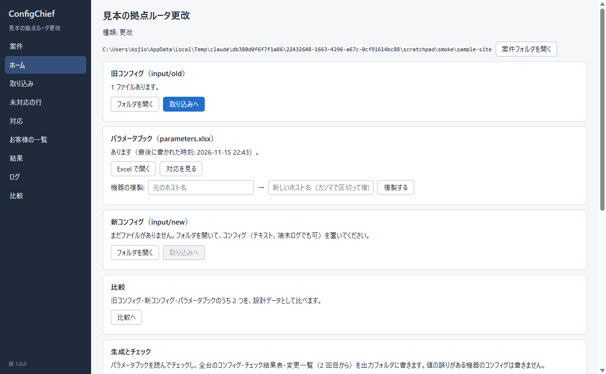
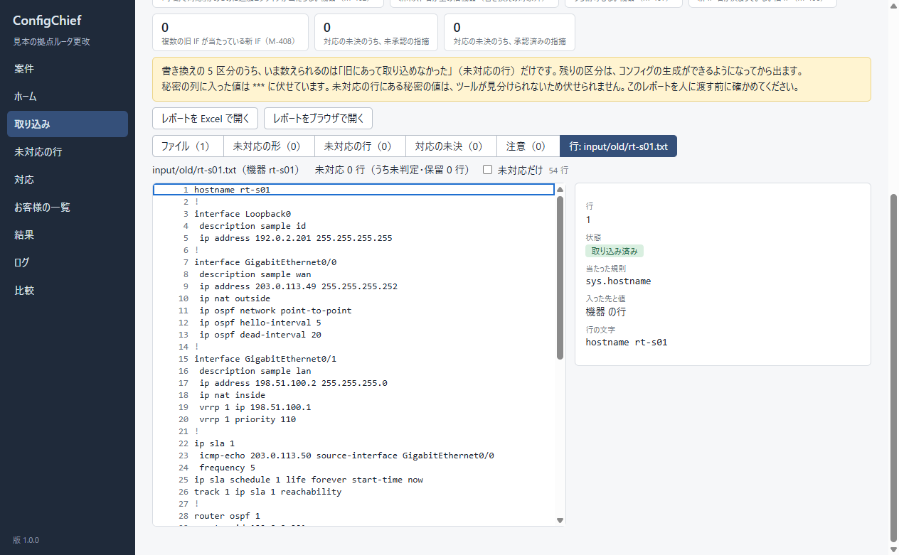
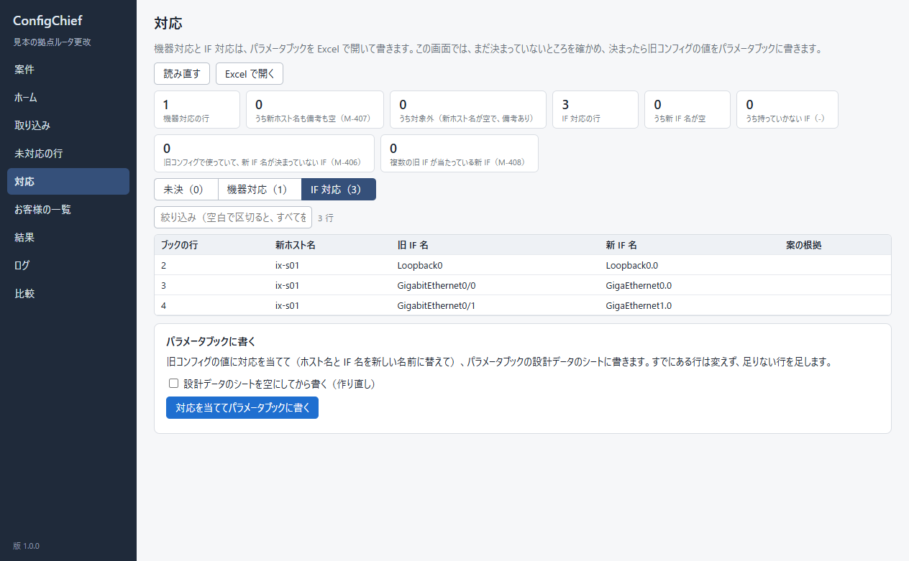
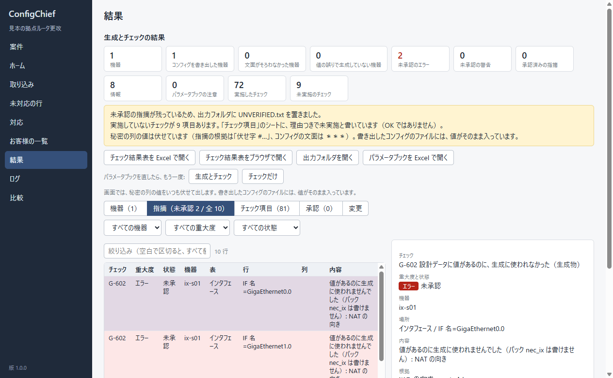

# ConfigChief の使い方

ConfigChief は、ネットワーク機器のコンフィグを読んでメーカーによらない表（Excel のパラメータブック）にし、その表からコンフィグ・チェック結果表・納品用のシートを出すツールです。

- exe 1 つで動きます。インストールは要りません。外部と通信しません
- 同じ入力からは、いつも同じ出力になります
- 読めなかった行は「未対応」として必ず一覧に出します（黙って落としません）
- 対応しているメーカーは Cisco IOS / IOS-XE と NEC UNIVERGE IX です。メーカーごとの読み方・書き方は「メーカーパック」というテキストのファイルにあり、足すことができます（[パックの書き方](pack-guide.md)）

> **大事な注意**: 同梱のパックは、メーカーが公開しているコマンドリファレンスを読んで作りました。**実機の出力では確かめていません。** 生成したコンフィグは、必ず検証機に流して確かめてから使ってください。何を確かめていないかは、各パックの README（`internal/packs/<パック>/README.md`）の「確かめていないこと」にあります。

ほかのページ: [シートと列の一覧](tables.md) ・ [チェックの一覧](checks.md) ・ [パックの書き方](pack-guide.md)

## 1. 起動する

`ConfigChief.exe` を置いて、ダブルクリックします。画面の表示には WebView2 ランタイム（Windows 11 には初めから入っています）が要ります。

- 署名の無い exe なので、初めて起動するときに Microsoft Defender SmartScreen の警告が出ることがあります。「詳細情報」→「実行」で起動できます。取った exe は、リリースのページの SHA-256 と比べて確かめられます（PowerShell: `Get-FileHash ConfigChief.exe`）
- 何も付けずに起動すると、画面が開きます。案件フォルダを付けて起動すると、その案件を開きます
- コマンドを付けて起動すると、窓を開かずにそのコマンドを行って終わります（8 章）
- 書き込むのは、案件フォルダの中と、`%APPDATA%\ConfigChief`（最近使った案件の一覧と、画面の作業フォルダ）だけです。レジストリは書きません



## 2. 案件フォルダ

1 つの案件が 1 つのフォルダです。中身はテキストと Excel だけなので、共有フォルダや git にそのまま置けます。

```
案件フォルダ/
  project.yaml       案件の設定
  parameters.xlsx    パラメータブック（値の正本）
  input/old/         旧機器のコンフィグ（1 台 1 ファイル。端末ログのままでも読めます）
  input/new/         手で書いた新コンフィグ（使うときだけ）
  input/customer/    お客様からもらった一覧（xlsx・xls・csv）
  input/logs/        検証機・本番の投入ログ、投入後の設定ログ
  extra/             追加コンフィグ（パックが書けない設定を、人が書いて差し込む）
  mappings/          お客様の一覧の、列の対応
  rules/             案件ごとのチェックのルール
  templates/         納品用パラメータシートのひな形
  packs/             案件専用のメーカーパック（同じ ID の同梱パックより優先）
  state/             判定・承認・控え・操作の記録
  out/<日時>/        実行 1 回ごとの出力（コンフィグ、レポート）
```

- ツールが書き換えるのは、パラメータブック（はっきり操作したときだけ。書く前に `state/backup/` へ控えを取ります）と、`state/`・`out/` だけです。`input/` と `extra/` は読むだけです
- パラメータブックを Excel で開いたままだと書けません。「Excel を閉じてください」と出たら、閉じてからやり直します
- 文字コードは UTF-8 と Shift_JIS を自動で見分けます

## 3. 更改の流れ（機器の入れ替え。同じメーカーでも別メーカーでも同じ）

1. **案件を作り、旧コンフィグを置く**: 画面の「案件」で作るか、`init`。旧機器のコンフィグを `input/old/` に入れます。端末ソフトのログ（`show running-config` を打った画面の保存）もそのまま置けます
2. **取り込む**: 画面の「取り込み」か `import`。行ごとに、取り込み済み・無視・未対応が色で分かります。パラメータブックができ、「機器対応」「IF 対応」のシートに案が入ります
   
3. **対応を決める**: Excel で「機器対応」（旧ホスト名 → 新ホスト名・新メーカー）と「IF 対応」（旧 IF 名 → 新 IF 名）を埋めます
4. **パラメータブックにする**: 「対応」の画面か `book`。対応を当てた設計データが、表ごとのシートに入ります。これ以降は、この Excel が値の正本です
   
5. **未対応の行を片付ける**: 画面の「未対応の行」か `judge`。同じ形の行をまとめて、「手動で対応」（追加コンフィグに書く）・「対応不要」・「保留」を付けます
6. **生成とチェック**: ホームの「生成とチェック」か `generate`。全台のコンフィグ（`out/<日時>/configs/`）と、チェック結果表（`reports/check_results.xlsx`・`.html`）が出ます。値の誤りがある機器のコンフィグは書きません
   
7. **指摘を直すか、承認する**: エラーと警告は、Excel の値を直すか、理由を付けて承認します。未承認の指摘が残っている間は、出力フォルダに `UNVERIFIED.txt` が置かれます
8. **検証機で確かめる**: 1 台分を検証機に流し、その端末ログを `input/logs/` に置いて、画面の「ログ」か `logs`。機器に弾かれた行が一覧に出ます
9. **変更が来たら**: Excel を直して 6 をやり直します。2 回目からは、前回から変わった機器と行の一覧（`reports/changes.xlsx`）が出ます
10. **納品物を出す**: ホームの「納品物」か `export`。納品用パラメータシートと、相手に渡すパラメータ表が出ます
11. **投入の後**: 投入後の設定のログを `input/logs/` に置いて、`verify`。パラメータブックから作ったコンフィグとの違いが出ます

### 別メーカーへ書き換えるとき

「機器対応」の新メーカーを変えると、同じパラメータブックから別メーカーのコンフィグが出ます。新しいメーカーで書けないものは、3 通りで知らせます。どれも黙って落としません。

| 出方 | 意味 | すること |
|---|---|---|
| G-602（エラー） | その列を、新しいメーカーのパックが書けない | 持っていかないならセルを空にする。別の書き方で持っていくなら、追加コンフィグに書いてセルを空にする |
| G-601・G-603・G-606（エラー） | 列は書けるが、その値の書き方が新しいメーカーに無い・足りない値がある | 指摘の文にある直し方のとおり、値を書き直す |
| G-614（警告） | パックが、新しいメーカーの書き方に置き換えて書いた（例: QoS の「残りの帯域の %」を「帯域の %」に） | 指摘の文を読み、置き換えでよければ承認する。よくなければ値を書き直す |

## 4. 新規構築の流れ

1. 案件を作り、ホームの「空のブックを作る（新規構築）」か `book --new`。見出しだけのパラメータブックができます。見出しのセルのコメントに、列の説明と記入例があります
2. 1 台目を、シート「機器」から書きます（ホスト名とメーカーは必須です）
3. 似た機器は、ホームの「機器の複製」か `clone --from <元> --to <新しいホスト名,…>` で増やします。値は元のままなので、アドレスなど機器ごとに違う値を直します（重なりはチェックが指摘します）
4. 全台に共通の値は、「機器」の列に `*`（全機器）か `@グループ名` を書いた 1 行で書けます。空の列をまとめて埋めたいときは、シート「共通値」を使います
5. あとは更改の 6 以降と同じです

### コンフィグを先に手で書く進め方

手で書いたコンフィグを `input/new/` に置いて取り込み、`book --from new` でパラメータブックにできます。旧コンフィグがあれば、「比較」で旧と新を比べて、入れ忘れと値の違いを確かめられます。

## 5. パラメータブック

- 1 つのシートが 1 種類の設定、1 行が設定 1 件です。シートと列の一覧は [tables.md](tables.md)
- 1 行目が見出しです。列の順番は自由で、定義に無い見出しの列を足してもかまいません（自由列。追加コンフィグと納品用シートから使えます）
- 有効・無効は `有効` `無効`、`○` `×`、`yes` `no`、`true` `false` のどれでも読みます
- 複数の値を持つ列は、カンマか改行で区切ります
- 秘密の値（パスワード・鍵）は平文で書きます。画面・チェック結果表・変更一覧では伏せ、生成するコンフィグには書きます
- 同じキーの行が「ホスト名」「`@グループ名`」「`*`」の複数にあるときは、ホスト名 ＞ グループ ＞ `*` の順で 1 行を取ります

## 6. チェックと承認

チェックの一覧は [checks.md](checks.md) です。

| 頭の字 | 種類 | 例 |
|---|---|---|
| V | 値 | 必須の値が空、アドレスの重なり、使われていない ACL |
| X | 対向（2 台の間） | IPsec の暗号が両端で違う、OSPF のエリアが違う |
| G | 生成 | 書けない値、生成した文面を読み直した結果が表と違う |
| M | 移行 | 旧との違い、対応が決まっていない IF |
| S | お客様の一覧 | 一覧とパラメータブックの値が違う |
| L | ログ | 機器に弾かれた行、投入後の設定との違い |

- **承認**: 指摘をそのまま受け入れるときは、理由と名前を付けて承認します（結果の画面で指摘を選ぶか、`approve`）。警告は「この機器の同じチェック」「全機器の同じチェック」とまとめて承認できます。エラーは 1 件ずつです
- **承認できない指摘**もあります（必須の値が空、文面が作れない、など）。値を直します
- 承認は `state/approvals.yaml` に残り、チェック結果表の「承認」のシートに出ます
- 重大度の変更・チェックの停止は、`project.yaml` の `checks.severity`・`checks.disable` に書きます

### 案件ごとのルール

`rules/*.yaml` に、その案件だけの決まりを書けます。生成とチェックのたびに全台に当てます。

```yaml
rules:
  - id: P-001
    title: 全台に NTP サーバがある
    severity: error
    require_line: '^ntp server '
  - id: P-002
    title: telnet を使わない
    severity: warning
    under: '^line vty'
    forbid_line: '^transport input .*telnet'
  - id: P-003
    title: インタフェースの説明は空にしない
    severity: warning
    table: interfaces
    where: 'row.enabled'
    expr: 'row.description != ""'
  - id: P-004
    title: NTP サーバは全台で同じ
    severity: warning
    equal_across: {table: ntp_servers, column: server}
```

種類は 5 つです: `require_line`（含むべき行）、`forbid_line`（含んではいけない行）、`expr`（行ごとの式）、`unique`（値の重複）、`equal_across`（全台で値がそろっているか）。`devices` で機器を絞れます（ホスト名・`@グループ`・`vendor:パックの ID`）。

## 7. パックが書けない設定（追加コンフィグ）

パックが対応していない設定は、`extra/` に書いて差し込みます。

| ファイル | 当たる機器 |
|---|---|
| `extra/_all.j2` | 全機器 |
| `extra/@グループ名.j2` | そのグループの機器 |
| `extra/ホスト名.j2` | その機器 |

- 書いた文面がそのまま出ます。Jinja2 の書き方で、パラメータブックの値を使えます（例: `{{ device.hostname }}`）
- 差し込む位置は、先頭の行で指定できます（例: `{# position: after interfaces #}`）。指定が無ければ、末尾の手前です

## 8. コマンドライン

画面と同じ処理を、窓を開かずに行えます。バッチファイルから呼ぶと、終わるまで待ち、`%ERRORLEVEL%` で終了コードを見られます（0 = 見るものなし、1 = 未承認の指摘などが残っている、2 = 実行できなかった）。

```
ConfigChief.exe init     <dir> [--name <案件名>] [--kind migration|new]
ConfigChief.exe import   --project <dir> [--source old|new] [--pack <ID>]
ConfigChief.exe book     --project <dir> [--from old|new] [--replace]
ConfigChief.exe book     --project <dir> --new
ConfigChief.exe clone    --project <dir> --from <ホスト名> --to <ホスト名>[,<ホスト名>…]
ConfigChief.exe compare  --project <dir> --a <old|new|book> --b <old|new|book>
ConfigChief.exe generate --project <dir> [--device <ホスト名>]
ConfigChief.exe check    --project <dir>
ConfigChief.exe approve  --project <dir> --finding <指紋> --reason <理由> --by <名前>
ConfigChief.exe approve  --project <dir> --rule <ID> --devices <範囲> [--table <表>] [--column <列>] --reason <理由> --by <名前>
ConfigChief.exe approve  --project <dir> --remove <承認の ID>
ConfigChief.exe judge    --project <dir> [--source old|new] [--all]
ConfigChief.exe judge    --project <dir> --group <ID> --verdict manual|not_needed|hold|none [--devices <範囲>] [--reason <理由>] --by <名前>
ConfigChief.exe customer --project <dir> [--draft <ファイル> [--sheet <シート>]] [--apply <指紋>,… | --apply-rule S-501|S-503 [--devices <範囲>]]
ConfigChief.exe export   --project <dir> --what sheet|peer|unhandled [--secrets show|mask] [--source old|new]
ConfigChief.exe logs     --project <dir>
ConfigChief.exe verify   --project <dir>
ConfigChief.exe sites    --project <dir> [--source book|old|new|logs]
ConfigChief.exe diff     <fileA> <fileB>
ConfigChief.exe diff     --tree <fileA> <fileB> [--keep-stamps] [--keep-secrets]
ConfigChief.exe diff     --tree --project <dir> --a <側> --b <側>
ConfigChief.exe pack test <パックのフォルダ> [--lines] [--dump]
ConfigChief.exe pack columns <パックのフォルダ>
ConfigChief.exe version
```

端末に直接打ったときは、Windows の決まりで、端末は終わりを待たずに次の入力を受け付けます（結果の文字は出ます）。待たせたいときは `start /wait ConfigChief.exe …` と打ちます。

## 9. そのほかの機能

- **比較**: 旧コンフィグ・新コンフィグ・パラメータブックのうち 2 つを、設計データとして比べます。文面どうしの比較（`diff`）と、階層を見た比較（`diff --tree`。親の行の下に違いを出します）もあります
- **お客様の一覧**: お客様からもらった Excel・CSV の列を、`mappings/` の列対応でパラメータブックの列に結び付け、値の違いを出します。選んだ値をパラメータブックに反映できます
- **多拠点の一覧**（`sites`）: 多くの拠点の同じ設定を、横に並べて見ます
- **納品用パラメータシート**: `templates/` に置いた Excel のひな形に、値を流し込みます。ひな形が無ければ標準の形で出します
- **未対応の行の持ち出し用レポート**（`export --what unhandled`）: 未対応の行を、値と名前を伏せた「形」にして出します。現場の外へ持ち出して、パックを直す材料にするためのものです。**渡す前に、必ず中身を見てください**

## 10. 困ったとき

| 起きたこと | 見るところ |
|---|---|
| メーカーを判定できない | 取り込みの画面で、候補からパックを選びます（`import --pack <ID>`） |
| 行が「未対応」になる | その行の理由が画面に出ます。パックの README の「読まない行」も見ます。設定として要るなら、追加コンフィグに書きます |
| 生成が止まる（コンフィグが出ない） | チェック結果表のエラーを見ます。値の誤り（V-101〜V-107・V-109）がある機器は書きません |
| G-604（往復の不一致）が出る | 生成した文面を読み直した結果が、表と違います。パックの不具合か、パックが書けない値です。指摘の場所の値を見ます |
| 機器に弾かれた | `logs` の一覧に、弾かれた行と機器の返事が出ます。実機の書き方がパックと違うときは、追加コンフィグで補うか、パックを直します |

## 11. 制限

- 実機の出力では確かめていません（冒頭の注意）
- 表示は日本語だけです
- 対応していない設定の例: ルートマップ、IKEv2、L2TP、VLAN・スイッチポート・LAG、IPv6 の経路制御。取り込みでは「未対応」になり、書き換えでは追加コンフィグで運びます
- 機種ごとのポート名の定義（新 IF 名の案を機種から作る機能）は、まだありません
